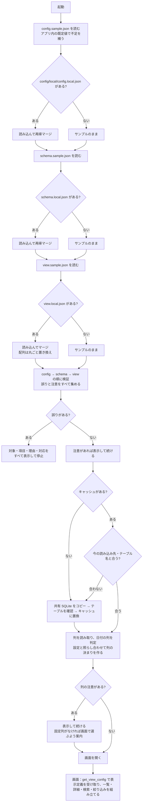

# 設定ファイルの設計

対象コード：`python/data_search/settings/`（`loader.py`・`merge.py`・`validation.py`）と `python/run_server.py`。
Rust 版では `src-tauri/src/config/` に同じ決まりで移す。

## 1. 目的

- ハードコーディングを避ける（DB パス・テーブル名・列名・表示項目・表示順をソースコードに書かない）
- 環境設定（config）・DB 定義（schema）・画面表示定義（view）を分ける
- 外部提供できるファイル（`config/sample`）と社内専用ファイル（`config/local`）を**フォルダで**分ける
- サンプルを初期値とし、ローカルは必要な項目だけを上書きする（全項目を重複して書かない）

## 2. フォルダ構成

```text
data-search/config/
├─ sample/                  外部提供可能（Git 管理対象・外部 AI へ渡してよい・社内情報を含めない）
│  ├─ config.sample.json
│  ├─ schema.sample.json
│  └─ view.sample.json
├─ local/                   社内専用（フォルダごと Git 管理対象外・外部へ出さない・なくても起動まで進む）
│  ├─ config.local.json
│  ├─ schema.local.json
│  └─ view.local.json
└─ dummy/                   ダミーデータ用の上書き（make_dummy_db.py が作る・Git 管理対象外）
   ├─ config.local.json
   └─ schema.local.json
```

`.gitignore` で `config/local/` と `config/dummy/` をフォルダごと除外する（`.gitkeep` は置かない。誤って中身を追跡しないため）。

## 3. 各ファイルの責務

| ファイル | 持つもの | 持たないもの |
|---|---|---|
| `config.sample.json` | アプリ基本情報、データソースの有効/無効・識別子・読み取り専用、共有 SQLite パスの**プレースホルダー**、キャッシュのパスと動作、検索の初期値、ログ、開発用サーバー | テーブル名、列名、論理と物理の対応、表示項目・表示順 |
| `config.local.json` | 実際の共有 SQLite のパスなど、環境で変わる値だけ | テーブル名、列名（schema へ） |
| `schema.sample.json` | データソース識別子、テーブル名の**プレースホルダー**、固定列（`recordKey`）、番号で探す列（`searchColumn`。`null` なら recordKey の 1 つ目）、任意の別名（`columns`：論理名 → DB の列名の**プレースホルダー**） | 全列の一覧（DB から自動で読み取る）、表示名（DB の列名を使う）、絞り込める列（全列で絞り込める） |
| `schema.local.json` | 実際のテーブル名。固定列・探す列（**DB の列名で書ける**。画面の「データ」→「固定列」で選ぶと、ここに保存される）。種類（`types`）は自動の判定を変えたいときだけ | 全列の一覧 |
| `view.sample.json` | 最初は隠す列（`hiddenColumns`）、既定の並べ替え（`defaultSort`）。任意で列ごとの補助（`fields`：等幅・コピー・入力例・値の札） | 物理列名、表示名、表示順（DB の列名・DB の順を使う）、絞り込み（全列で使える） |
| `view.local.json` | 社内環境だけの変更（なくてよい）。隠す列を DB の列名で書くのはここ | — |

`recordKey`・`searchColumn`・`types` は依頼書に明記がなかったため、**DB の論理構造**として schema に置いた（「固定列（レコードキー＝行を 1 件に決める列）」「番号で探す列」「日付として比べる列」はデータの性質であり、表示の都合ではないため）。

列名が DB にあるかは、**キャッシュのテーブルを読んだあと**に `column_model.py` が照らし合わせる（起動時の検証では書き方だけを確かめる）。
DB にない名前があっても止めず、画面の「データ」パネルと起動時の黒いウィンドウに「列の注意」を出す。固定列がそろわないときは、画面で選び直すよう案内する（似た構成の別の DB も、設定ファイルを手で直さずに使えるようにするため）。

## 4. 起動時の読み込み順

1. `config/sample/config.sample.json` を読み込む
2. `config/local/config.local.json` があれば読み込む
3. ローカルをサンプルへ再帰マージする
4. `config/sample/schema.sample.json` を読み込む
5. `config/local/schema.local.json` があれば読み込む
6. ローカルをサンプルへ再帰マージする
7. `config/sample/view.sample.json` を読み込む
8. `config/local/view.local.json` があれば読み込む
9. ローカルをサンプルへマージする
10. マージ後の config・schema・view を検証する（誤りはすべて集めてから止める）
11. schema に従って共有 SQLite をコピーし、テーブルの存在を確かめてからキャッシュとして使う
12. キャッシュのテーブルの列を読み取り、値から日付の列を判定する（`column_catalog.py`）。設定と照らし合わせて列の決まり（並び・種類・固定列・探す列・注意）を作る（`column_model.py`）
13. 画面は最初に `get_view_config` で表示定義を受け取って組み立てる

`--local-dir` で `config/local` の代わりのフォルダを指定できる（ダミー用：`config/dummy`）。

## 5. マージ仕様（`settings/merge.py` の `deep_merge`）

| ローカル側の状態 | 結果 |
|---|---|
| キーがない | サンプルの値のまま（誤りにしない。例：`devServer` を書かなくてよい） |
| 両方がオブジェクト `{ }` | キーごとに再帰的に重ねる |
| 配列 `[ ]` | 要素ごとに重ねず、**配列全体を置き換える**（例：`schema.recordKey`・`view.hiddenColumns`） |
| 型がサンプルと違う | 使わず、型の誤りとして止める（サンプルの値が `null` なら何でも受け入れる。整数は数値の代わりに使える） |
| サンプルにないキー | **読み捨てない**。ファイル名と項目の道筋を示して「設定の注意」を出し、その値は使わない |
| サンプルにないキー（列を足せる場所） | `schema.types`・`view.fields` は新しいキー（DB の列名）を受け入れて使う |

- サンプル側のオブジェクトは変更しない（新しいオブジェクトを作る）。
- サンプルを読んだ直後に、アプリ内の既定値（`settings/defaults.py` の `BUILTIN_DEFAULTS`）でサンプルにないキーを補う（`fill_defaults`）。
  サンプルに書いてある値が常に優先。補ったキーはサンプルにあるのと同じ扱いになり、local で上書きしても注意は出ない。

| 補う既定値 | 値 |
|---|---|
| `config.cache` | `temporaryExtension: ".tmp"`・`keepPreviousOnFailure: true` |
| `config.devServer` | `host: "127.0.0.1"`・`port: 8765`・`openBrowser: true` |
| `schema.types` | `{}`（種類は値から判定） |
| `schema.columns` / `schema.searchColumn` | `{}`（別名なし） / `null`（recordKey の 1 つ目で探す） |
| `view.fields` / `view.hiddenColumns` | `{}` / `[]` |
- ローカルのファイルがないときは、空の上書き `{}` として扱う。

例（view）：

```jsonc
// schema.sample.json：recordKey ["lotNo", "boxNo"]・searchColumn null
// schema.local.json
{ "tableName": "T_LOT", "recordKey": ["LOT_NO"] }
// 結果：recordKey は 1 列だけ（配列は丸ごと置き換え）。searchColumn は null のまま（LOT_NO で探す）
```

## 6. 検証（`settings/validation.py`）

仮の値（`<...>` の形）の判定は役割ごとに行う。`config.local.json` にテーブル名や列名がないことは誤りにしない。

### 6.1 config

- 各 JSON が解析できる・同じキーが重複していない・全体がオブジェクト
- `dataSource.sourcePath`・`cachePath` が仮の値でも空でもない（**接続先のパスは config で確かめる**）
- `dataSource.enabled` が true、`readOnly` が true
- `search.pageSize`・`maxPageSize` が正の整数で、`pageSize ≤ maxPageSize`
- `devServer.port` が 1〜65535、`devServer.host` が 127.0.0.1 か localhost
- `logging.level`・`search.defaultMatchMode`・`cache.temporaryExtension` の値

### 6.2 schema

- `tableName` が空でも仮の値でもない（**テーブル名・列名は schema で確かめる**）
- `recordKey` が 1〜3 個の空でない名前で、重複していない。`searchColumn` は `null` か空でない名前
- `columns`（別名）は任意。値が文字列でないときだけ誤り。仮の値のままの別名は使わない（誤りにしない）
- 同じキーが重複していない（JSON の読み込み時に検出）
- `dataSourceId` が config の `dataSource.id` と同じ（別のデータソースの設定を組み合わせないため）
- `types` は型が text / date
- 名前が DB にあるかは、ここでは確かめない（キャッシュを読んだあと `column_model.py` が照らし合わせ、ない名前は止めずに「列の注意」で知らせる）
- 接続後（キャッシュ作成時）に確かめるのはテーブルがあることだけ（`cache_validator.py`）。列はそのとき読み取る（`column_catalog.py`）
- 以前の形で全列を書いた `columns` は、サンプルにない分を「使っていない」と 1 件の注意にまとめる（止めない）

### 6.3 view

- `defaultSort.order` が asc / desc。`field` は空でない名前（DB にない名前なら、固定列の順に並べて「列の注意」を出す）
- `hiddenColumns` は空でない文字列（DB の列名か別名。DB にない名前は無視）
- `fields.<列>` の `mono`・`copy` が真偽値、`badge` のパターンと色が正しい。`label`・`group` は「今は使わない」と注意
- 以前の形の `searchFields`・`filters`・`listColumns`・`detailFields`・`detailGroups` は「今は使わない項目」と注意（止めない）

### 6.4 列の注意（キャッシュを読んだあと。`column_model.py`）

| 食い違い | 動き |
|---|---|
| 固定列が DB にない | 固定列を空にする（一部の列だけでは 1 件に決まらないため）。一覧・絞り込みは使える。1 つ目の列があれば番号でも探せる。画面は「固定列を選ぶ」へ案内 |
| 番号で探す列が DB にない | 固定列の 1 つ目で探す |
| 並べ替え・種類の指定の列が DB にない | その指定を使わない |

### 6.5 誤りの表示

誤りはすべて集め、1 件ごとに次の形で表示して止まる（注意は止めずに表示する）。

```text
[設定エラー]
対象: config/local/schema.local.json
項目: recordKey
理由: 固定列が 4 個あります。
対応: 3 個までにしてください。
```

- 「対象」は、その値を直すべきファイル。仮の値が残っているときは、サンプルではなく**ローカルのファイル**を示す（サンプルに実際の値を書かせないため）。
- ローカルのファイルがないこと自体は誤りにしない。公開サンプルだけでも検証まで進み、ローカルに書くべき項目をファイル名つきで示して止まる。

## 7. 起動フロー



文字だけで見る場合：

```text
起動
 ├─ config：sample を読む → local があれば再帰マージ
 ├─ schema：sample を読む → local があれば再帰マージ
 ├─ view  ：sample を読む → local があればマージ（配列は丸ごと置き換え）
 ├─ 検証（config → schema → view）
 │    ├─ 誤りあり → 対象・項目・理由・対応をすべて表示して停止
 │    └─ 注意あり → 表示して続ける（未知のキーなど）
 ├─ キャッシュがない／今の読み込み先・テーブル名と合わない → 作る（コピー → テーブルの確認 → 置換）
 │    └─ 作れなければ古いキャッシュは使わず、画面で「データを更新してください」と示す
 ├─ 列を読み取り、日付の列を判定 → 設定と照らし合わせて列の決まりを作る
 │    └─ 食い違いは「列の注意」として表示して続ける（固定列がなければ画面で選ぶ）
 └─ 画面：表示定義を受け取って組み立てる
```

## 8. 旧構成からの移行

| 旧（`config/config.local.json`） | 新 |
|---|---|
| `application` | `config/local/config.local.json`（変える項目だけ） |
| `dataSource.id` | `config/local/config.local.json`（変えるときは `schema.local.json` の `dataSourceId` も同じ値に） |
| `dataSource.enabled` | 基本はサンプル。必要なときだけ `config.local.json` |
| `dataSource.sourcePath` | `config/local/config.local.json` |
| `dataSource.cachePath` | 基本はサンプル（`./data/cache/target-data.sqlite3`）。必要なときだけ `config.local.json` |
| `dataSource.tableName` | `config/local/schema.local.json` の `tableName` |
| `dataSource.readOnly` | 基本はサンプル |
| `fieldMappings` | 不要（列名は DB と同じでよい）。固定列は `config/local/schema.local.json` の `recordKey` に DB の列名で書くか、画面で選ぶ。論理名で書きたいときだけ `columns`（別名） |
| `cache` / `search` / `logging` / `devServer` | 基本はサンプル。必要なときだけ `config.local.json` |
| （ソースコード内の表示名・表示順・検索対象・絞り込み・状態の色分け・既定の並べ替え） | 表示名・表示順は DB のまま。検索対象は `schema.searchColumn`。絞り込みは全列。色分け・既定の並べ替えは `config/sample/view.sample.json`（社内だけの変更は `view.local.json`） |
| （ソースコード内の 1 件を特定する項目・日付の項目） | `schema` の `recordKey`（画面でも選べる）。日付の列は値から判定（変えたいときだけ `types`） |

旧 `config.local.json` の `dataSource.tableName` や `fieldMappings` を新しい `config.local.json` にそのまま残すと、
サンプルにないキーとして「設定の注意」が出る（使われない）。`schema.local.json` へ移すこと。

## 9. 列と表示名（column_catalog.py・column_model.py）

- 列は、キャッシュのテーブルから読み取る（`PRAGMA table_info`）。設定には役割（固定列・探す列など）だけを書く。
- **列の id も表示名も DB の列名そのもの**（詳細・一覧の見出し・絞り込み・タグ・保存した表示の設定で共通）。表示名の設定はない。
- 設定の名前の読み替え：DB に同じ名前の列があればその列、なければ別名（`schema.columns`）として DB の列名に読み替える。どちらもなければ使わない。
- 種類：`schema.types` の指定が優先。指定がなければ値から判定する（空でない値がすべて `YYYY-MM-DD…`・`YYYY/MM/DD…`・`YYYYMMDD` なら日付。月・日の 1 桁目まで見て番号との取り違えを減らす。固定列・探す列は文字）。判定はキャッシュを作り直したときに 1 回だけ、表を列のまとまりごとに 1 回ずつ読んで行う。
- 並び：固定列 → 番号で探す列 → 別名のある列（`schema.columns` の順）→ ほかの列（DB の順）。
- `get_view_config` は列の一覧（`columns`）・固定列・探す列・別名・列の注意と、並びの印（`columnsVersion`）を返す。データの更新や固定列の変更で印が変わると、画面は読み込み直す。
- 画面は、以前の形（論理名）で保存したタグ・表示列・列幅・入力の履歴を、別名を使って DB の列名に読み替える。
- テーブル名と読み込み先のパスは画面に渡さない。DB の列名は表示名として画面に渡す（ログには残さない）。

## 9.1 画面からの書き込み（読み込み先・固定列）

- 画面から書き換えるのは次の 2 つだけ。sample は書き換えない。
  - `config.local.json` の `dataSource.sourcePath`（`update_data_source`）。接続テスト（`source_check.py`）で × がないときだけ書き込む（△＝固定列がない、は保存してから選び直せる）。
  - `schema.local.json` の `recordKey`・`searchColumn`（`update_record_settings`）。DB にある列だけ。DB の列名で書く。探す列が固定列の 1 つ目と同じなら `null`。
- ほかのキーは残し、書き換え前を `.bak` に残し、一時ファイル → 置き換えで書く（`settings/local_writer.py`）。
- 書き込み後に `load_settings` で読み直して検証し、誤りがあれば `.bak` に戻す。問題がなければ動いている設定を差し替える（`settings_updater.py`。読み込み先とで共通）。
- キャッシュの状態ファイルに読み込み先の印（パスのハッシュ）を残し、前の読み込み先のキャッシュは使わない。

## 10. 設定項目を足すときの手順

1. `config/sample/` の該当ファイルにキーを足す（社内情報でない既定値、または `<...>` の仮の値）
2. `settings/loader.py` で受け取り、`settings/validation.py` で値を確かめる
3. view / schema を変えたら `python python/tools/sync_sample_view.py`（画面だけで試すモード用の表示定義を作り直す）
4. 社内の値が必要な環境だけ、`config/local/` の該当ファイルに書き足す（不要なら何もしない）
