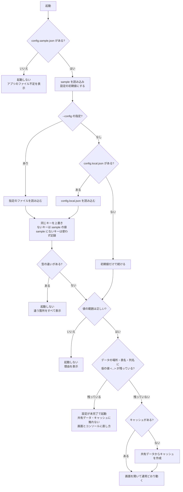

# 設定ファイルの読み込み設計

対象：`python/data_search/config_loader.py`（Rust 版では `src-tauri/src/config/loader.rs` に同じ決まりで移す）

## 1. 役割

| ファイル | 役割 | Git | 外部 AI へ | 中身 |
|---|---|---|---|---|
| `config/config.sample.json` | **正式な設定スキーマ兼初期値** | 管理する | 渡してよい | すべてのキー。社内情報は含めない（データの場所・表名・列名は仮の値 `<...>`） |
| `config/config.local.json` | 社内専用の上書き | 管理しない（.gitignore） | 渡さない | **変えたい項目だけ**。なくても起動できる |
| `config/config.dummy.json` | ダミーデータ用の上書き | 管理しない（自動生成） | — | `make_dummy_db.py` が作る。local と同じく必要な項目だけ |

- `config.sample.json` を更新しても、`config.local.json` の修正は**必須ではない**（新しいキーは sample の値で動く）。
- 新しいキーの値を社内の値にしたいときだけ、`config.local.json` にそのキーを書き足す。

## 2. 読み込みの流れ

1. `config.sample.json` を読み込み、設定の初期値とする（ないときは起動しない。アプリのファイル不足のため）
2. `config.local.json` が**ある場合だけ**読み込む（`--config` を指定したときは、そのファイルを代わりに使う）
3. 同じキーは `config.local.json` の値で上書きする
4. `config.local.json` にないキーは `config.sample.json` の値を使う
5. 重ねた結果の値の範囲を確かめる
6. 仮の値（`<...>`）が残っている設定を調べる
   - データの場所・表名・列名に残っている → **「設定が未完了」で起動**（共有データ・キャッシュには触れない）
   - それ以外に残っている → sample の作り方の誤りとして起動しない

## 3. 重ね合わせ（マージ）の決まり

`merge_settings(sample, local)` は、sample を壊さずに新しい設定を作る。

| local の状態 | 結果 | 例 |
|---|---|---|
| キーがない | sample の値を使う（**エラーにしない**） | local に `devServer` がない → sample の `devServer` を使う |
| キーがあり、型が同じ | local の値で置き換える | `"tableName": "実際の表名"` |
| 両方がオブジェクト `{ }` | 中身をキーごとに重ねる（入れ子も同じ） | local の `fieldMappings` に `lotNo` だけ → ほかの 11 項目は sample の値 |
| キーがあり、型が違う | 起動しない（違う箇所をすべて表示） | `"pageSize": "100"`（文字列）→ 整数にしてください |
| sample にないキー | 使わない。起動はし、**書き間違いの可能性として表示** | `"table"`（正しくは `tableName`）、`"dataSources"` |

- 型は「文字列／整数／数値／true・false／オブジェクト／配列／null」で比べる（`true` と `1` は別物）。
- 配列は（今の sample にはないが）中身を重ねず、丸ごと置き換える。
- 値の範囲（`pageSize ≤ maxPageSize`、`readOnly` は true など）は**重ねたあと**に確かめる。

### 例

```jsonc
// config.sample.json（抜粋）
{ "dataSource": { "sourcePath": "<SHARED_SQLITE_PATH>", "tableName": "<TARGET_TABLE_NAME>", "readOnly": true },
  "devServer":  { "host": "127.0.0.1", "port": 8765, "openBrowser": true } }

// config.local.json（必要な項目だけ）
{ "dataSource": { "sourcePath": "Z:/shared/data.sqlite3", "tableName": "t_lot" } }

// 重ねた結果
{ "dataSource": { "sourcePath": "Z:/shared/data.sqlite3", "tableName": "t_lot", "readOnly": true },
  "devServer":  { "host": "127.0.0.1", "port": 8765, "openBrowser": true } }
```

## 4. 起動フロー



文字だけで見る場合：

```
起動
 ├─ config.sample.json を読む ──（ない）→ 起動しない
 ├─ 上書きファイルを決める：--config ＞ config.local.json ＞ なし
 ├─ 上書き：同じキーは上書き / ないキーは sample の値 / sample にないキーは使わず記録
 │    └─（型が違う）→ 起動しない（違う箇所をすべて表示）
 ├─ 値の範囲を確かめる ──（誤り）→ 起動しない
 ├─ 仮の値が残っている？
 │    ├─ データの場所・表名・列名 → 「設定が未完了」で起動（データには触れない）
 │    └─ それ以外             → 起動しない
 └─ 通常どおり起動（キャッシュがなければ作成）
```

## 5. 起動時の表示

```
設定の初期値: …\config\config.sample.json
上書き      : …\config\config.local.json        ← ないときは「なし（初期値だけで起動）」
  上書きした項目: 15 個
  [注意] 次の項目は config.sample.json にないため使いませんでした（書き間違いの可能性）:
    ・dataSource.table
[設定が未完了] 次の項目が仮の値（<...>）のままのため、データは表示できません。
  ・dataSource.tableName
```

画面では、上部バー右の札（設定が未完了）と、左の「データ」パネルに同じ内容を出す。
ログには上書きした項目の**数**と、使わなかったキーの**名前**だけを残す（値は残さない）。

## 6. 設定項目を足すときの手順

1. `config.sample.json` にキーを足す（社内情報でない既定値、または仮の値 `<...>`）
2. `config_loader.py` の `AppConfig` と `load_config()` で受け取り、必要なら値の範囲を `_check_values()` に足す
3. 仮の値のままでは動けない項目なら `REQUIRED_SETTINGS` に足す
4. 社内の値が必要な環境だけ、`config.local.json` にそのキーを書き足す（不要なら何もしない）
