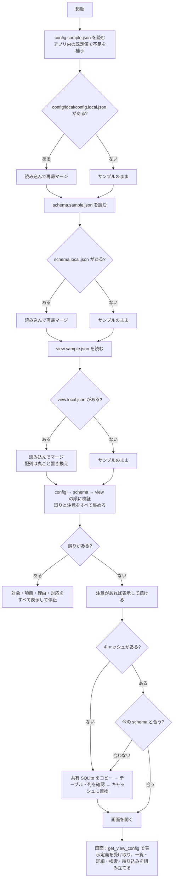

# 設定ファイルの設計

対象コード：`python/data_search/settings/`（`loader.py`・`merge.py`・`validation.py`）と `python/run_server.py`。
Rust 版では `src-tauri/src/config/` に同じ決まりで移す。

## 1. 目的

- ハードコーディングを避ける（DB パス・テーブル名・列名・表示項目・表示順をソースコードに書かない）
- 環境設定（config）・DB 定義（schema）・画面表示定義（view）を分ける
- 外部提供できるファイル（`config/sample`）と社内専用ファイル（`config/local`）を**フォルダで**分ける
- サンプルを初期値とし、ローカルは必要な項目だけを上書きする（全項目を重複して書かない）

## 2. フォルダ構成

```text
data-search/config/
├─ sample/                  外部提供可能（Git 管理対象・外部 AI へ渡してよい・社内情報を含めない）
│  ├─ config.sample.json
│  ├─ schema.sample.json
│  └─ view.sample.json
├─ local/                   社内専用（フォルダごと Git 管理対象外・外部へ出さない・なくても起動まで進む）
│  ├─ config.local.json
│  ├─ schema.local.json
│  └─ view.local.json
└─ dummy/                   ダミーデータ用の上書き（make_dummy_db.py が作る・Git 管理対象外）
   ├─ config.local.json
   └─ schema.local.json
```

`.gitignore` で `config/local/` と `config/dummy/` をフォルダごと除外する（`.gitkeep` は置かない。誤って中身を追跡しないため）。

## 3. 各ファイルの責務

| ファイル | 持つもの | 持たないもの |
|---|---|---|
| `config.sample.json` | アプリ基本情報、データソースの有効/無効・識別子・読み取り専用、共有 SQLite パスの**プレースホルダー**、キャッシュのパスと動作、検索の初期値、ログ、開発用サーバー | テーブル名、列名、論理と物理の対応、表示項目・表示順 |
| `config.local.json` | 実際の共有 SQLite のパスなど、環境で変わる値だけ | テーブル名、列名（schema へ） |
| `schema.sample.json` | データソース識別子、テーブル名の**プレースホルダー**、**役割のある 14 列**の論理名と DB の列名（**プレースホルダー**）の対応、1 件を特定する項目（`recordKey`）、日付として扱う列（`types`） | 役割のない列（DB から自動で読み取る）、表示名（DB の列名を使う） |
| `schema.local.json` | 実際のテーブル名と、役割のある列の実際の列名。日付の列（役割のない列は DB の列名で書ける） | 役割のない列の一覧（書くと「使っていない」と注意） |
| `view.sample.json` | 番号で探せる列（`searchFields`）、最初は隠す列（`hiddenColumns`）、絞り込み（`filters`）、既定の並べ替え（`defaultSort`）。任意で列ごとの補助（`fields`：等幅・コピー・入力例・値の札） | 物理列名、表示名、表示順（DB の列名・DB の順を使う） |
| `view.local.json` | 社内環境だけの変更（なくてよい）。隠す列を DB の列名で書くのはここ | — |

`recordKey` と `types` は依頼書に明記がなかったため、**DB の論理構造**として schema に置いた（「1 件を特定する列」「日付として比べる列」はデータの性質であり、表示の都合ではないため）。

## 4. 起動時の読み込み順

1. `config/sample/config.sample.json` を読み込む
2. `config/local/config.local.json` があれば読み込む
3. ローカルをサンプルへ再帰マージする
4. `config/sample/schema.sample.json` を読み込む
5. `config/local/schema.local.json` があれば読み込む
6. ローカルをサンプルへ再帰マージする
7. `config/sample/view.sample.json` を読み込む
8. `config/local/view.local.json` があれば読み込む
9. ローカルをサンプルへマージする
10. マージ後の config・schema・view を検証する（誤りはすべて集めてから止める）
11. schema に従って共有 SQLite をコピーし、テーブルと列の存在を確かめてからキャッシュとして使う
12. view に従って検索画面を組み立てる（画面は最初に `get_view_config` で表示定義を受け取る）

`--local-dir` で `config/local` の代わりのフォルダを指定できる（ダミー用：`config/dummy`）。

## 5. マージ仕様（`settings/merge.py` の `deep_merge`）

| ローカル側の状態 | 結果 |
|---|---|
| キーがない | サンプルの値のまま（誤りにしない。例：`devServer` を書かなくてよい） |
| 両方がオブジェクト `{ }` | キーごとに再帰的に重ねる |
| 配列 `[ ]` | 要素ごとに重ねず、**配列全体を置き換える**（例：`view.searchFields`） |
| 型がサンプルと違う | 使わず、型の誤りとして止める（サンプルの値が `null` なら何でも受け入れる。整数は数値の代わりに使える） |
| サンプルにないキー | **読み捨てない**。ファイル名と項目の道筋を示して「設定の注意」を出し、その値は使わない |
| サンプルにないキー（論理項目を足せる場所） | `schema.columns`・`schema.types`・`view.fields` は新しいキーを受け入れて使う（社内だけの論理項目を足せるように） |

- サンプル側のオブジェクトは変更しない（新しいオブジェクトを作る）。
- サンプルを読んだ直後に、アプリ内の既定値（`settings/defaults.py` の `BUILTIN_DEFAULTS`）でサンプルにないキーを補う（`fill_defaults`）。
  サンプルに書いてある値が常に優先。補ったキーはサンプルにあるのと同じ扱いになり、local で上書きしても注意は出ない。

| 補う既定値 | 値 |
|---|---|
| `config.cache` | `temporaryExtension: ".tmp"`・`keepPreviousOnFailure: true` |
| `config.devServer` | `host: "127.0.0.1"`・`port: 8765`・`openBrowser: true` |
| `schema.types` | `{}`（日付の項目なし） |
| `view.detailGroups` / `view.fields` / `view.filters` | `[]` / `{}` / `[]` |
- ローカルのファイルがないときは、空の上書き `{}` として扱う。

例（view）：

```jsonc
// view.sample.json：searchFields 6 列・filters 8 列
// view.local.json
{ "searchFields": ["lotNo"] }
// 結果：searchFields は 1 列だけ（配列は丸ごと置き換え）。hiddenColumns・filters はサンプルのまま
```

## 6. 検証（`settings/validation.py`）

仮の値（`<...>` の形）の判定は役割ごとに行う。`config.local.json` にテーブル名や列名がないことは誤りにしない。

### 6.1 config

- 各 JSON が解析できる・同じキーが重複していない・全体がオブジェクト
- `dataSource.sourcePath`・`cachePath` が仮の値でも空でもない（**接続先のパスは config で確かめる**）
- `dataSource.enabled` が true、`readOnly` が true
- `search.pageSize`・`maxPageSize` が正の整数で、`pageSize ≤ maxPageSize`
- `devServer.port` が 1〜65535、`devServer.host` が 127.0.0.1 か localhost
- `logging.level`・`search.defaultMatchMode`・`cache.temporaryExtension` の値

### 6.2 schema

- `tableName` が空でも仮の値でもない（**テーブル名・列名は schema で確かめる**）
- `columns` がオブジェクトで、論理名・物理列名が空でも仮の値でもない
- 同じキー（論理名）が重複していない（JSON の読み込み時に検出）
- `dataSourceId` が config の `dataSource.id` と同じ（別のデータソースの設定を組み合わせないため）
- `recordKey` の論理名が `columns` にある。`types` は型が text / date（キーは役割のない列の DB の列名でもよいため、有無は確かめない）
- 接続後（キャッシュ作成時）にテーブルと、役割のある列がすべてあること（`cache_validator.py`）。ほかの列はそのとき読み取る（`column_catalog.py`）
- 以前の形で全列を書いた `columns` は、役割のない分を「使っていない」と 1 件の注意にまとめる（止めない）

### 6.3 view

- `searchFields`・`filters`・`defaultSort` が参照する論理名が、**マージ後の `schema.columns`** にある。重複していない。番号で探せる列が少なくとも 1 つある
- `filters` の `type` が values / date。date は schema の `types` で date の列だけ
- `hiddenColumns` は空でない文字列（論理名か DB の列名。DB にない名前は無視）
- `fields.<列>` の `mono`・`copy` が真偽値、`badge` のパターンと色が正しい。`label`・`group` は「今は使わない」と注意
- 以前の形の `listColumns`・`detailFields`・`detailGroups` は「今は使わない項目」と注意（止めない）

### 6.4 誤りの表示

誤りはすべて集め、1 件ごとに次の形で表示して止まる（注意は止めずに表示する）。

```text
[設定エラー]
対象: config/sample/view.sample.json
項目: searchFields[2]
理由: "productNo" はマージ後の schema.columns に定義されていません。
対応: schema側へ論理項目を追加するか、view側のfieldを修正してください。
```

- 「対象」は、その値を直すべきファイル。仮の値が残っているときは、サンプルではなく**ローカルのファイル**を示す（サンプルに実際の値を書かせないため）。
- ローカルのファイルがないこと自体は誤りにしない。公開サンプルだけでも検証まで進み、ローカルに書くべき項目をファイル名つきで示して止まる。

## 7. 起動フロー



文字だけで見る場合：

```text
起動
 ├─ config：sample を読む → local があれば再帰マージ
 ├─ schema：sample を読む → local があれば再帰マージ
 ├─ view  ：sample を読む → local があればマージ（配列は丸ごと置き換え）
 ├─ 検証（config → schema → view）
 │    ├─ 誤りあり → 対象・項目・理由・対応をすべて表示して停止
 │    └─ 注意あり → 表示して続ける（未知のキーなど）
 ├─ キャッシュがない／今の schema（テーブル名・列名）と合わない → 作る（コピー → テーブル・列の確認 → 置換）
 │    └─ 作れなければ古いキャッシュは使わず、画面で「データを更新してください」と示す
 └─ 画面：表示定義を受け取って組み立てる
```

## 8. 旧構成からの移行

| 旧（`config/config.local.json`） | 新 |
|---|---|
| `application` | `config/local/config.local.json`（変える項目だけ） |
| `dataSource.id` | `config/local/config.local.json`（変えるときは `schema.local.json` の `dataSourceId` も同じ値に） |
| `dataSource.enabled` | 基本はサンプル。必要なときだけ `config.local.json` |
| `dataSource.sourcePath` | `config/local/config.local.json` |
| `dataSource.cachePath` | 基本はサンプル（`./data/cache/target-data.sqlite3`）。必要なときだけ `config.local.json` |
| `dataSource.tableName` | `config/local/schema.local.json` の `tableName` |
| `dataSource.readOnly` | 基本はサンプル |
| `fieldMappings` | `config/local/schema.local.json` の `columns` |
| `cache` / `search` / `logging` / `devServer` | 基本はサンプル。必要なときだけ `config.local.json` |
| （ソースコード内の表示名・表示順・検索対象・絞り込み・状態の色分け・既定の並べ替え） | `config/sample/view.sample.json`（社内だけの変更は `view.local.json`） |
| （ソースコード内の 1 件を特定する項目・日付の項目） | `config/sample/schema.sample.json` の `recordKey`・`types` |

旧 `config.local.json` の `dataSource.tableName` や `fieldMappings` を新しい `config.local.json` にそのまま残すと、
サンプルにないキーとして「設定の注意」が出る（使われない）。`schema.local.json` へ移すこと。

## 9. 列と表示名（column_catalog.py）

- 表示する列は、キャッシュのテーブルから読み取る（`PRAGMA table_info`）。設定には役割のある列だけを書く。
- 表示名は DB の列名そのもの（詳細・一覧の見出し・検索の種類・絞り込みで共通）。表示名の設定はない。
- 並び：役割のある列（`schema.columns` の順）→ ほかの列（DB の順）。列の id は役割のある列が論理名、ほかは DB の列名
  （DB の列名が別の列の論理名と同じなら `名前#2` で区別）。
- `get_view_config` は列の一覧（`columns`）と並びの印（`columnsVersion`）を返す。データの更新で印が変わると画面は読み込み直す。
- テーブル名と読み込み先のパスは画面に渡さない。DB の列名は表示名として画面に渡す（ログには残さない）。

## 9.1 画面からの書き込み（読み込み先）

- 画面から書き換えるのは `config.local.json` の `dataSource.sourcePath` だけ（`update_data_source`）。sample は書き換えない。
- 接続テスト（`source_check.py`）がすべて ○ のときだけ書き込む。ほかのキーは残し、書き換え前を `.bak` に残し、一時ファイル → 置き換えで書く（`settings/local_writer.py`）。
- 書き込み後に `load_settings` で読み直して検証し、誤りがあれば `.bak` に戻す。
- キャッシュの状態ファイルに読み込み先の印（パスのハッシュ）を残し、前の読み込み先のキャッシュは使わない。

## 10. 設定項目を足すときの手順

1. `config/sample/` の該当ファイルにキーを足す（社内情報でない既定値、または `<...>` の仮の値）
2. `settings/loader.py` で受け取り、`settings/validation.py` で値を確かめる
3. view / schema を変えたら `python python/tools/sync_sample_view.py`（画面だけで試すモード用の表示定義を作り直す）
4. 社内の値が必要な環境だけ、`config/local/` の該当ファイルに書き足す（不要なら何もしない）
