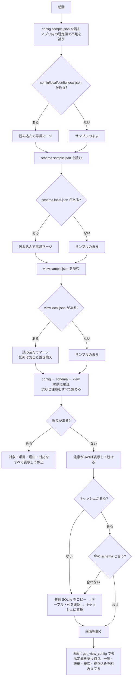

## 付録：バックエンド・ツール・設定の修正ファイルの全文（1/2）

`docs/config-design.md`

````markdown
# 設定ファイルの設計

対象コード：`python/data_search/settings/`（`loader.py`・`merge.py`・`validation.py`）と `python/run_server.py`。
Rust 版では `src-tauri/src/config/` に同じ決まりで移す。

## 1. 目的

- ハードコーディングを避ける（DB パス・テーブル名・列名・表示項目・表示順をソースコードに書かない）
- 環境設定（config）・DB 定義（schema）・画面表示定義（view）を分ける
- 外部提供できるファイル（`config/sample`）と社内専用ファイル（`config/local`）を**フォルダで**分ける
- サンプルを初期値とし、ローカルは必要な項目だけを上書きする（全項目を重複して書かない）

## 2. フォルダ構成

```text
data-search/config/
├─ sample/                  外部提供可能（Git 管理対象・外部 AI へ渡してよい・社内情報を含めない）
│  ├─ config.sample.json
│  ├─ schema.sample.json
│  └─ view.sample.json
├─ local/                   社内専用（フォルダごと Git 管理対象外・外部へ出さない・なくても起動まで進む）
│  ├─ config.local.json
│  ├─ schema.local.json
│  └─ view.local.json
└─ dummy/                   ダミーデータ用の上書き（make_dummy_db.py が作る・Git 管理対象外）
   ├─ config.local.json
   └─ schema.local.json
```

`.gitignore` で `config/local/` と `config/dummy/` をフォルダごと除外する（`.gitkeep` は置かない。誤って中身を追跡しないため）。

## 3. 各ファイルの責務

| ファイル | 持つもの | 持たないもの |
|---|---|---|
| `config.sample.json` | アプリ基本情報、データソースの有効/無効・識別子・読み取り専用、共有 SQLite パスの**プレースホルダー**、キャッシュのパスと動作、検索の初期値、ログ、開発用サーバー | テーブル名、列名、論理と物理の対応、表示項目・表示順 |
| `config.local.json` | 実際の共有 SQLite のパスなど、環境で変わる値だけ | テーブル名、列名（schema へ） |
| `schema.sample.json` | データソース識別子、テーブル名の**プレースホルダー**、**役割のある 14 列**の論理名と DB の列名（**プレースホルダー**）の対応、1 件を特定する項目（`recordKey`）、日付として扱う列（`types`） | 役割のない列（DB から自動で読み取る）、表示名（DB の列名を使う） |
| `schema.local.json` | 実際のテーブル名と、役割のある列の実際の列名。日付の列（役割のない列は DB の列名で書ける） | 役割のない列の一覧（書くと「使っていない」と注意） |
| `view.sample.json` | 番号で探せる列（`searchFields`）、最初は隠す列（`hiddenColumns`）、絞り込み（`filters`）、既定の並べ替え（`defaultSort`）。任意で列ごとの補助（`fields`：等幅・コピー・入力例・値の札） | 物理列名、表示名、表示順（DB の列名・DB の順を使う） |
| `view.local.json` | 社内環境だけの変更（なくてよい）。隠す列を DB の列名で書くのはここ | — |

`recordKey` と `types` は依頼書に明記がなかったため、**DB の論理構造**として schema に置いた（「1 件を特定する列」「日付として比べる列」はデータの性質であり、表示の都合ではないため）。

## 4. 起動時の読み込み順

1. `config/sample/config.sample.json` を読み込む
2. `config/local/config.local.json` があれば読み込む
3. ローカルをサンプルへ再帰マージする
4. `config/sample/schema.sample.json` を読み込む
5. `config/local/schema.local.json` があれば読み込む
6. ローカルをサンプルへ再帰マージする
7. `config/sample/view.sample.json` を読み込む
8. `config/local/view.local.json` があれば読み込む
9. ローカルをサンプルへマージする
10. マージ後の config・schema・view を検証する（誤りはすべて集めてから止める）
11. schema に従って共有 SQLite をコピーし、テーブルと列の存在を確かめてからキャッシュとして使う
12. view に従って検索画面を組み立てる（画面は最初に `get_view_config` で表示定義を受け取る）

`--local-dir` で `config/local` の代わりのフォルダを指定できる（ダミー用：`config/dummy`）。

## 5. マージ仕様（`settings/merge.py` の `deep_merge`）

| ローカル側の状態 | 結果 |
|---|---|
| キーがない | サンプルの値のまま（誤りにしない。例：`devServer` を書かなくてよい） |
| 両方がオブジェクト `{ }` | キーごとに再帰的に重ねる |
| 配列 `[ ]` | 要素ごとに重ねず、**配列全体を置き換える**（例：`view.searchFields`） |
| 型がサンプルと違う | 使わず、型の誤りとして止める（サンプルの値が `null` なら何でも受け入れる。整数は数値の代わりに使える） |
| サンプルにないキー | **読み捨てない**。ファイル名と項目の道筋を示して「設定の注意」を出し、その値は使わない |
| サンプルにないキー（論理項目を足せる場所） | `schema.columns`・`schema.types`・`view.fields` は新しいキーを受け入れて使う（社内だけの論理項目を足せるように） |

- サンプル側のオブジェクトは変更しない（新しいオブジェクトを作る）。
- サンプルを読んだ直後に、アプリ内の既定値（`settings/defaults.py` の `BUILTIN_DEFAULTS`）でサンプルにないキーを補う（`fill_defaults`）。
  サンプルに書いてある値が常に優先。補ったキーはサンプルにあるのと同じ扱いになり、local で上書きしても注意は出ない。

| 補う既定値 | 値 |
|---|---|
| `config.cache` | `temporaryExtension: ".tmp"`・`keepPreviousOnFailure: true` |
| `config.devServer` | `host: "127.0.0.1"`・`port: 8765`・`openBrowser: true` |
| `schema.types` | `{}`（日付の項目なし） |
| `view.detailGroups` / `view.fields` / `view.filters` | `[]` / `{}` / `[]` |
- ローカルのファイルがないときは、空の上書き `{}` として扱う。

例（view）：

```jsonc
// view.sample.json：searchFields 6 列・filters 8 列
// view.local.json
{ "searchFields": ["lotNo"] }
// 結果：searchFields は 1 列だけ（配列は丸ごと置き換え）。hiddenColumns・filters はサンプルのまま
```

## 6. 検証（`settings/validation.py`）

仮の値（`<...>` の形）の判定は役割ごとに行う。`config.local.json` にテーブル名や列名がないことは誤りにしない。

### 6.1 config

- 各 JSON が解析できる・同じキーが重複していない・全体がオブジェクト
- `dataSource.sourcePath`・`cachePath` が仮の値でも空でもない（**接続先のパスは config で確かめる**）
- `dataSource.enabled` が true、`readOnly` が true
- `search.pageSize`・`maxPageSize` が正の整数で、`pageSize ≤ maxPageSize`
- `devServer.port` が 1〜65535、`devServer.host` が 127.0.0.1 か localhost
- `logging.level`・`search.defaultMatchMode`・`cache.temporaryExtension` の値

### 6.2 schema

- `tableName` が空でも仮の値でもない（**テーブル名・列名は schema で確かめる**）
- `columns` がオブジェクトで、論理名・物理列名が空でも仮の値でもない
- 同じキー（論理名）が重複していない（JSON の読み込み時に検出）
- `dataSourceId` が config の `dataSource.id` と同じ（別のデータソースの設定を組み合わせないため）
- `recordKey` の論理名が `columns` にある。`types` は型が text / date（キーは役割のない列の DB の列名でもよいため、有無は確かめない）
- 接続後（キャッシュ作成時）にテーブルと、役割のある列がすべてあること（`cache_validator.py`）。ほかの列はそのとき読み取る（`column_catalog.py`）
- 以前の形で全列を書いた `columns` は、役割のない分を「使っていない」と 1 件の注意にまとめる（止めない）

### 6.3 view

- `searchFields`・`filters`・`defaultSort` が参照する論理名が、**マージ後の `schema.columns`** にある。重複していない。番号で探せる列が少なくとも 1 つある
- `filters` の `type` が values / date。date は schema の `types` で date の列だけ
- `hiddenColumns` は空でない文字列（論理名か DB の列名。DB にない名前は無視）
- `fields.<列>` の `mono`・`copy` が真偽値、`badge` のパターンと色が正しい。`label`・`group` は「今は使わない」と注意
- 以前の形の `listColumns`・`detailFields`・`detailGroups` は「今は使わない項目」と注意（止めない）

### 6.4 誤りの表示

誤りはすべて集め、1 件ごとに次の形で表示して止まる（注意は止めずに表示する）。

```text
[設定エラー]
対象: config/sample/view.sample.json
項目: searchFields[2]
理由: "productNo" はマージ後の schema.columns に定義されていません。
対応: schema側へ論理項目を追加するか、view側のfieldを修正してください。
```

- 「対象」は、その値を直すべきファイル。仮の値が残っているときは、サンプルではなく**ローカルのファイル**を示す（サンプルに実際の値を書かせないため）。
- ローカルのファイルがないこと自体は誤りにしない。公開サンプルだけでも検証まで進み、ローカルに書くべき項目をファイル名つきで示して止まる。

## 7. 起動フロー



文字だけで見る場合：

```text
起動
 ├─ config：sample を読む → local があれば再帰マージ
 ├─ schema：sample を読む → local があれば再帰マージ
 ├─ view  ：sample を読む → local があればマージ（配列は丸ごと置き換え）
 ├─ 検証（config → schema → view）
 │    ├─ 誤りあり → 対象・項目・理由・対応をすべて表示して停止
 │    └─ 注意あり → 表示して続ける（未知のキーなど）
 ├─ キャッシュがない／今の schema（テーブル名・列名）と合わない → 作る（コピー → テーブル・列の確認 → 置換）
 │    └─ 作れなければ古いキャッシュは使わず、画面で「データを更新してください」と示す
 └─ 画面：表示定義を受け取って組み立てる
```

## 8. 旧構成からの移行

| 旧（`config/config.local.json`） | 新 |
|---|---|
| `application` | `config/local/config.local.json`（変える項目だけ） |
| `dataSource.id` | `config/local/config.local.json`（変えるときは `schema.local.json` の `dataSourceId` も同じ値に） |
| `dataSource.enabled` | 基本はサンプル。必要なときだけ `config.local.json` |
| `dataSource.sourcePath` | `config/local/config.local.json` |
| `dataSource.cachePath` | 基本はサンプル（`./data/cache/target-data.sqlite3`）。必要なときだけ `config.local.json` |
| `dataSource.tableName` | `config/local/schema.local.json` の `tableName` |
| `dataSource.readOnly` | 基本はサンプル |
| `fieldMappings` | `config/local/schema.local.json` の `columns` |
| `cache` / `search` / `logging` / `devServer` | 基本はサンプル。必要なときだけ `config.local.json` |
| （ソースコード内の表示名・表示順・検索対象・絞り込み・状態の色分け・既定の並べ替え） | `config/sample/view.sample.json`（社内だけの変更は `view.local.json`） |
| （ソースコード内の 1 件を特定する項目・日付の項目） | `config/sample/schema.sample.json` の `recordKey`・`types` |

旧 `config.local.json` の `dataSource.tableName` や `fieldMappings` を新しい `config.local.json` にそのまま残すと、
サンプルにないキーとして「設定の注意」が出る（使われない）。`schema.local.json` へ移すこと。

## 9. 列と表示名（column_catalog.py）

- 表示する列は、キャッシュのテーブルから読み取る（`PRAGMA table_info`）。設定には役割のある列だけを書く。
- 表示名は DB の列名そのもの（詳細・一覧の見出し・検索の種類・絞り込みで共通）。表示名の設定はない。
- 並び：役割のある列（`schema.columns` の順）→ ほかの列（DB の順）。列の id は役割のある列が論理名、ほかは DB の列名
  （DB の列名が別の列の論理名と同じなら `名前#2` で区別）。
- `get_view_config` は列の一覧（`columns`）と並びの印（`columnsVersion`）を返す。データの更新で印が変わると画面は読み込み直す。
- テーブル名と読み込み先のパスは画面に渡さない。DB の列名は表示名として画面に渡す（ログには残さない）。

## 9.1 画面からの書き込み（読み込み先）

- 画面から書き換えるのは `config.local.json` の `dataSource.sourcePath` だけ（`update_data_source`）。sample は書き換えない。
- 接続テスト（`source_check.py`）がすべて ○ のときだけ書き込む。ほかのキーは残し、書き換え前を `.bak` に残し、一時ファイル → 置き換えで書く（`settings/local_writer.py`）。
- 書き込み後に `load_settings` で読み直して検証し、誤りがあれば `.bak` に戻す。
- キャッシュの状態ファイルに読み込み先の印（パスのハッシュ）を残し、前の読み込み先のキャッシュは使わない。

## 10. 設定項目を足すときの手順

1. `config/sample/` の該当ファイルにキーを足す（社内情報でない既定値、または `<...>` の仮の値）
2. `settings/loader.py` で受け取り、`settings/validation.py` で値を確かめる
3. view / schema を変えたら `python python/tools/sync_sample_view.py`（画面だけで試すモード用の表示定義を作り直す）
4. 社内の値が必要な環境だけ、`config/local/` の該当ファイルに書き足す（不要なら何もしない）
````

`python/data_search/__init__.py`

```python
"""対象データ検索ツールの Python 版バックエンド（試用・検証用）。

Rust/Tauri 版へ移植しやすいよう、モジュール構成を src-tauri/src の構成に合わせている。

    settings/       ↔ config/（loader.rs・merge.rs・validation.rs）
    fields          ↔ models/lot.rs
    cache_copier    ↔ cache/copier.rs
    cache_validator ↔ cache/validator.rs
    cache_service   ↔ cache/mod.rs
    query           ↔ db/query.rs
    lot_service     ↔ services/lot_service.rs
    commands        ↔ commands/*.rs
    errors          ↔ errors/mod.rs
    logging_setup   ↔ logging/mod.rs
"""
```

`python/data_search/cache_copier.py`

```python
"""共有 SQLite を一時ファイルへコピーする。共有側には書き込まない。"""

import os
import shutil
import sqlite3

from .errors import AppError

SIDE_FILE_SUFFIXES = ("-wal",)


def source_modified_at(source_path):
    """共有データの更新時刻（UNIX 秒）。接続できなければ None。"""
    try:
        return os.stat(source_path).st_mtime
    except OSError:
        return None


def remove_quietly(path):
    for target in (path, path + "-wal", path + "-shm", path + "-journal"):
        try:
            os.remove(target)
        except FileNotFoundError:
            pass
        except OSError:
            pass


def copy_to_temp(source_path, temp_path):
    """共有データを temp_path へコピーし、コピー開始時の共有データの更新時刻を返す。

    コピー中に共有データが更新された場合は、中途半端な状態を避けるため失敗とする。
    """
    before = source_modified_at(source_path)
    if before is None or not os.path.isfile(source_path):
        raise AppError("SOURCE_UNAVAILABLE", "source not reachable")  # パスはログに残さない

    os.makedirs(os.path.dirname(temp_path) or ".", exist_ok=True)
    remove_quietly(temp_path)
    try:
        shutil.copyfile(source_path, temp_path)
        for suffix in SIDE_FILE_SUFFIXES:
            if os.path.isfile(source_path + suffix):
                shutil.copyfile(source_path + suffix, temp_path + suffix)
    except OSError as exc:
        remove_quietly(temp_path)
        raise AppError("CACHE_COPY_FAILED", f"copy failed: {type(exc).__name__} errno={exc.errno}") from exc

    if source_modified_at(source_path) != before:
        remove_quietly(temp_path)
        raise AppError("SOURCE_BUSY", "source modified during copy")

    _merge_wal(temp_path)
    return before


def _merge_wal(temp_path):
    """WAL を一緒にコピーした場合は一時ファイルへ取り込み、キャッシュを 1 ファイルにする。"""
    if not os.path.isfile(temp_path + "-wal"):
        return
    try:
        conn = sqlite3.connect(temp_path)
        try:
            conn.execute("PRAGMA journal_mode=DELETE")
        finally:
            conn.close()
    except sqlite3.DatabaseError:
        # 壊れている場合は検証で弾く
        pass
```

`python/data_search/cache_service.py`

```python
"""ローカルキャッシュの更新と状態管理。

更新の流れ：共有データ → 一時ファイルへコピー → 検証 → 問題がなければ置換。
失敗したときは直前の正常なキャッシュを使い続ける。
"""

import hashlib
import json
import os
import sqlite3
import threading
from contextlib import contextmanager
from datetime import datetime

from . import cache_copier
from .column_catalog import build_catalog, catalog_from_file, catalog_version
from .cache_validator import open_readonly, validate_cache_file
from .errors import AppError


def source_id(path):
    """読み込み先を見分ける印（パスそのものは状態ファイルに残さない）。"""
    return hashlib.sha256(os.path.normcase(os.path.abspath(path)).encode("utf-8")).hexdigest()[:16]


def to_iso(timestamp):
    if timestamp is None:
        return None
    return datetime.fromtimestamp(timestamp).astimezone().isoformat(timespec="seconds")


class CacheService:
    def __init__(self, config, logger):
        self.config = config
        self.logger = logger
        self.cache_path = config.cache_path
        self.temp_path = config.cache_path + config.temporary_extension
        self.state_path = config.cache_path + ".status.json"
        # 置換中に検索が走らないよう、更新と読み取りを 1 本の鍵で順番にする
        self.lock = threading.RLock()
        # 今の schema（テーブル名・列名）と合わないキャッシュは使わない。
        # SQLite は存在しない列名を "..." で書くと文字列として扱うため、合わないまま検索すると誤った値が返る。
        self.stale = False
        self._catalog = None  # 表示する列の一覧（キャッシュから読み取る。キャッシュが変わったら作り直す）

    # ── 列の一覧 ──
    def catalog(self):
        """表示する列（column_catalog.Column の並び）。キャッシュがなければ役割のある列だけ。"""
        with self.lock:
            if not self.cache_available():
                return build_catalog([], self.config.field_mappings)
            if self._catalog is None:
                self._catalog = catalog_from_file(open_readonly, self.cache_path, self.config.table_name, self.config.field_mappings)
                self.logger.info("column catalog columns=%d", len(self._catalog))  # 列名は残さない
            return self._catalog

    # ── 状態の読み書き ──
    def _read_state(self):
        try:
            with open(self.state_path, encoding="utf-8") as fp:
                return json.load(fp)
        except (OSError, ValueError):
            return {}

    def _write_state(self, state):
        os.makedirs(os.path.dirname(self.state_path) or ".", exist_ok=True)
        temp = self.state_path + ".writing"
        with open(temp, "w", encoding="utf-8") as fp:
            json.dump(state, fp, ensure_ascii=False, indent=2)
        os.replace(temp, self.state_path)

    def use_config(self, config):
        """読み込み先の変更などで設定を差し替える。前の読み込み先から作ったキャッシュは使わない。"""
        with self.lock:
            self.config = config
            self._catalog = None
            if not self._same_source():
                self.stale = True

    def _same_source(self):
        recorded = self._read_state().get("sourceId")
        # 印がない（この仕組みより前に作った）キャッシュは、今の読み込み先のものとみなす
        return recorded is None or recorded == source_id(self.config.source_path)

    def cache_available(self):
        return os.path.isfile(self.cache_path) and not self.stale

    def verify_existing(self):
        """手元のキャッシュが今の schema と合うかを確かめる（起動時）。合わなければ使わない印を付けて False。"""
        if not os.path.isfile(self.cache_path):
            return False
        if not self._same_source():
            self.stale = True
            self.logger.warning("existing cache was built from another source")
            return False
        try:
            validate_cache_file(self.cache_path, self.config.table_name, self.config.field_mappings)
            self.stale = False
            return True
        except AppError as error:
            self.stale = True
            self.logger.warning("existing cache does not match schema code=%s detail=%s", error.code, error.detail)
            return False

    # ── 更新 ──
    def refresh(self):
        with self.lock:
            self.logger.info("cache refresh started")
            state = self._read_state()
            try:
                source_mtime = cache_copier.copy_to_temp(self.config.source_path, self.temp_path)
                row_count = validate_cache_file(self.temp_path, self.config.table_name, self.config.field_mappings)
                os.makedirs(os.path.dirname(self.cache_path) or ".", exist_ok=True)
                os.replace(self.temp_path, self.cache_path)
                self.stale = False
                self._catalog = None
            except AppError as error:
                cache_copier.remove_quietly(self.temp_path)
                using_previous = self.cache_available()
                self.logger.warning(
                    "cache refresh failed code=%s detail=%s using_previous=%s",
                    error.code, error.detail, using_previous,
                )
                state.update({
                    "lastRefreshSucceeded": False,
                    "lastRefreshAt": to_iso(datetime.now().timestamp()),
                    "usingPreviousCache": using_previous,
                    "errorCode": error.code,
                    "errorMessage": error.user_message,
                })
                self._write_state(state)
                raise
            except OSError as exc:
                cache_copier.remove_quietly(self.temp_path)
                raise AppError("CACHE_COPY_FAILED", f"replace failed: {type(exc).__name__} errno={exc.errno}") from exc

            now = datetime.now().timestamp()
            state = {
                "lastRefreshSucceeded": True,
                "lastRefreshAt": to_iso(now),
                "sourceModifiedAt": to_iso(source_mtime),
                "sourceModifiedTs": source_mtime,
                "cacheUpdatedAt": to_iso(now),
                "usingPreviousCache": False,
                "rowCount": row_count,
                "sourceId": source_id(self.config.source_path),
                "errorCode": None,
                "errorMessage": None,
            }
            self._write_state(state)
            self.logger.info("cache refresh succeeded rows=%s", row_count)
            return {
                "success": True,
                "sourceModifiedAt": state["sourceModifiedAt"],
                "cacheUpdatedAt": state["cacheUpdatedAt"],
                "usingPreviousCache": False,
                "rowCount": row_count,
                "message": "キャッシュを更新しました。",
            }

    # ── 状態 ──
    def status(self):
        # 設定の注意（未知のキーなど）は画面の「データ」パネルにも出す。値は含めない
        config_info = {
            "settingsWarnings": [
                {"file": w.file, "path": w.path, "reason": w.reason, "action": w.action} for w in self.config.warnings
            ],
        }
        state = self._read_state()
        available = self.cache_available()
        current_source = cache_copier.source_modified_at(self.config.source_path)
        cached_source = state.get("sourceModifiedTs")
        has_update = bool(available and current_source and cached_source and current_source > cached_source)
        succeeded = state.get("lastRefreshSucceeded", available)

        if not available and self.stale:
            message = ("手元のキャッシュは前の読み込み先から作ったため使っていません。データを更新してください。"
                       if not self._same_source() else
                       "手元のキャッシュが今の設定（テーブル名・列名）と合わないため使っていません。データを更新してください。")
        elif not available:
            message = "検索できるデータがまだありません。データを更新してください。"
        elif not succeeded:
            message = "最新のデータを取得できなかったため、前回のデータを参照しています。"
        elif has_update:
            message = "共有データに新しい更新があります。必要に応じてデータを更新してください。"
        else:
            message = "最新のキャッシュを参照しています。"

        return dict(config_info, **{
            "available": available,
            "lastRefreshSucceeded": bool(succeeded),
            "sourceModifiedAt": state.get("sourceModifiedAt"),
            "cacheUpdatedAt": state.get("cacheUpdatedAt"),
            "usingPreviousCache": bool(available and not succeeded),
            "message": message,
            "rowCount": state.get("rowCount"),
            "sourceReachable": current_source is not None,
            "sourceHasUpdate": has_update,
            "lastRefreshAt": state.get("lastRefreshAt"),
            "errorCode": None if succeeded else state.get("errorCode"),
            "errorMessage": None if succeeded else state.get("errorMessage"),
            # 列の並びの印。変わったら画面は表示定義を読み直す
            "columnsVersion": catalog_version(self.catalog()),
        })

    # ── 読み取り ──
    @contextmanager
    def read_connection(self):
        with self.lock:
            if not self.cache_available():
                raise AppError("CACHE_UNAVAILABLE", "cache file not found")
            try:
                conn = open_readonly(self.cache_path)
            except sqlite3.Error as exc:
                raise AppError("CACHE_UNAVAILABLE", f"cannot open cache: {exc}") from exc
            try:
                yield conn
            finally:
                conn.close()
```

`python/data_search/column_catalog.py`

```python
"""表示する列の一覧（カタログ）。キャッシュのテーブルから列を読み取り、DB の列名をそのまま表示名にする。

    並び順 … 役割のある列（schema.columns の順）を先に、残りは DB の列の順
    id     … 役割のある列は論理名（検索・絞り込みなどで使う）。ほかの列は DB の列名
             （DB の列名が、別の列の論理名と同じになったときは「名前#2」のように区別する）
    label  … DB の列名（画面の見出し・詳細・絞り込みで共通）

設定に書くのは役割のある列だけでよく、DB に列が増えれば自動で表示される。
"""

import hashlib
import sqlite3
from dataclasses import dataclass

from .query import quote_identifier


@dataclass(frozen=True)
class Column:
    id: str
    physical: str
    role: bool

    def public(self):
        return {"id": self.id, "label": self.physical, "role": self.role}


def build_catalog(table_columns, field_mappings):
    """table_columns：DB の列名（DB の順）。field_mappings：役割のある列の 論理名 → DB の列名。"""
    role_physical = set(field_mappings.values())
    columns = [Column(name, physical, True) for name, physical in field_mappings.items()]
    used = set(field_mappings)
    for physical in table_columns:
        if physical in role_physical:
            continue
        column_id, number = physical, 2
        while column_id in used:
            column_id, number = f"{physical}#{number}", number + 1
        used.add(column_id)
        columns.append(Column(column_id, physical, False))
    return tuple(columns)


def read_table_columns(conn, table_name):
    return [row[1] for row in conn.execute(f"PRAGMA table_info({quote_identifier(table_name)})")]


def catalog_from_file(open_connection, path, table_name, field_mappings):
    """キャッシュのファイルから作る。読めなければ役割のある列だけ（画面はそれだけで動く）。"""
    try:
        conn = open_connection(path)
        try:
            return build_catalog(read_table_columns(conn, table_name), field_mappings)
        finally:
            conn.close()
    except sqlite3.Error:
        return build_catalog([], field_mappings)


def catalog_version(columns):
    """列の並びが変わったかを画面が見分けるための印。"""
    text = "\u001f".join(f"{c.id}\u001e{c.physical}" for c in columns)
    return hashlib.sha256(text.encode("utf-8")).hexdigest()[:12]
```

`python/data_search/commands.py`

```python
"""Tauri Command と同じ名前・同じ入出力の命令を登録する。

命令を増やすときは @command("名前") を付けた関数を足すだけでよい（既存の処理は変えない）。
"""

from .column_catalog import catalog_version
from .errors import AppError

_REGISTRY = {}


def command(name):
    def decorator(func):
        _REGISTRY[name] = func
        return func
    return decorator


def command_names():
    return sorted(_REGISTRY)


def dispatch(name, context, payload):
    handler = _REGISTRY.get(name)
    if handler is None:
        raise AppError("UNKNOWN_COMMAND", f"unknown command: {name}")
    return handler(context, payload)


@command("search_lots")
def search_lots(ctx, payload):
    return ctx.lot_service.search(payload)


@command("list_lots")
def list_lots(ctx, payload):
    return ctx.lot_service.list(payload)


@command("get_filter_values")
def get_filter_values(ctx, payload):
    return ctx.lot_service.filter_values(payload)


@command("get_lot_detail")
def get_lot_detail(ctx, payload):
    return ctx.lot_service.detail(payload)


@command("refresh_cache")
def refresh_cache(ctx, payload):
    return ctx.cache_service.refresh()


@command("get_cache_status")
def get_cache_status(ctx, payload):
    return ctx.cache_service.status()


@command("get_data_source")
def get_data_source(ctx, payload):
    """今の読み込み先（共有 SQLite のパス）。手元の画面にだけ出す（ログには残さない）。"""
    return ctx.source_service.describe()


@command("test_data_source")
def test_data_source(ctx, payload):
    """接続テスト。sourcePath を省くと今の読み込み先を確かめる。コピーも書き込みもしない。"""
    return ctx.source_service.test(payload)


@command("update_data_source")
def update_data_source(ctx, payload):
    """接続テストがすべて ○ なら config.local.json に保存し、キャッシュを作り直す。"""
    return ctx.source_service.update(payload)


@command("get_view_config")
def get_view_config(ctx, payload):
    """画面の表示定義（view と schema の論理情報）と、表示する列（DB の列名が表示名）。テーブル名・パスは含めない。"""
    columns = ctx.cache_service.catalog()
    return dict(ctx.config.public_view(), success=True,
                columns=[column.public() for column in columns], columnsVersion=catalog_version(columns))


@command("get_application_info")
def get_application_info(ctx, payload):
    return {
        "id": ctx.config.app_id,
        "name": ctx.config.app_name,
        "version": ctx.config.app_version,
    }
```

`python/data_search/errors.py`

```python
"""利用者向けメッセージと技術ログを分けるためのエラー型。

画面へ出すのは code と userMessage と detailId だけ。技術的な詳細（パス・OS エラーなど）は
detail に入れてログにだけ残す。
"""

import uuid

# code → 利用者向けメッセージ（次に取る行動が分かる文にする）
USER_MESSAGES = {
    "CONFIG_INVALID": "設定に誤りがあります。表示された「対象・項目・理由・対応」に沿って直してください。",
    "SOURCE_UNAVAILABLE": "共有データに接続できません。ネットワークと共有フォルダを確認してください。",
    "SOURCE_BUSY": "共有データが更新中のため取得できませんでした。少し待ってからもう一度更新してください。",
    "CACHE_COPY_FAILED": "共有データをコピーできませんでした。少し待ってからもう一度更新してください。",
    "CACHE_INVALID": "取得したデータが壊れていたため、使用しませんでした。",
    "CACHE_TABLE_MISSING": "取得したデータに必要な表がないため、使用しませんでした。schema.local.json の tableName を確認してください。",
    "CACHE_COLUMN_MISSING": "取得したデータに必要な列がないため、使用しませんでした。schema.local.json の columns を確認してください。",
    "CACHE_UNAVAILABLE": "検索できるデータがまだありません。データを更新してください。",
    "SETTINGS_WRITE_FAILED": "設定ファイルに書き込めませんでした。config/local フォルダの権限と、ほかのアプリで開いていないかを確認してください。",
    "INVALID_REQUEST": "検索の条件が正しくありません。入力内容を確認してください。",
    "NOT_FOUND": "選んだデータが見つかりません。データが更新された可能性があります。もう一度検索してください。",
    "UNKNOWN_COMMAND": "この操作には対応していません。",
    "INTERNAL_ERROR": "予期しないエラーが発生しました。もう一度試し、続く場合は管理者へ連絡してください。",
}


class AppError(Exception):
    """アプリケーションで扱うエラー。"""

    def __init__(self, code, detail="", user_message=None):
        super().__init__(f"{code}: {detail}")
        self.code = code
        self.detail = detail
        self.user_message = user_message or USER_MESSAGES.get(code, USER_MESSAGES["INTERNAL_ERROR"])


def new_detail_id():
    """ログと画面を結び付ける短い ID。"""
    return uuid.uuid4().hex[:12].upper()


def error_response(error, detail_id):
    return {
        "success": False,
        "error": {
            "code": error.code,
            "userMessage": error.user_message,
            "detailId": detail_id,
        },
    }
```

`python/data_search/fields.py`

```python
"""検索・絞り込みの決まり（上限値など）。

論理項目の名前・検索できる項目・絞り込みの種類・1 件を特定する鍵は、ここには書かない。
config/sample の schema / view（とローカルの上書き）から settings.DataModel として組み立てる。
"""

FILTER_VALUES_MAX = 200      # 1 項目で選べる値の数の上限
FILTER_VALUE_LENGTH_MAX = 200
VALUE_LIST_LIMIT = 200       # 値の一覧として返す数の上限
RELATIVE_DAYS_MAX = 3650

MATCH_MODES = ("partial", "exact")
SORT_ORDERS = ("asc", "desc")

KEYWORD_MAX_LENGTH = 100
```

`python/data_search/http_server.py`

```python
"""画面（src/）の配信と、命令（POST /api/<命令名>）の受付を行うローカル専用サーバー。

・127.0.0.1 だけで待ち受け、ほかの PC からは接続させない。
・Host / Origin を確かめ、ほかのサイトから命令を呼ばれないようにする。
・ファイルの配信は src/ の中だけに限る（任意のファイルパスは受け付けない）。
"""

import json
import os
from dataclasses import dataclass
from functools import partial
from http.server import SimpleHTTPRequestHandler, ThreadingHTTPServer

from . import commands
from .errors import AppError, error_response, new_detail_id

MAX_BODY_BYTES = 64 * 1024
API_PREFIX = "/api/"

# Windows のレジストリ次第で .js が text/plain になるのを防ぐ
CONTENT_TYPES = {
    ".html": "text/html; charset=utf-8",
    ".js": "text/javascript; charset=utf-8",
    ".css": "text/css; charset=utf-8",
    ".json": "application/json; charset=utf-8",
    ".svg": "image/svg+xml",
    ".png": "image/png",
    ".ico": "image/x-icon",
    ".woff2": "font/woff2",
    ".ttf": "font/ttf",
    ".txt": "text/plain; charset=utf-8",
}


@dataclass
class AppContext:
    config: object
    cache_service: object
    lot_service: object
    logger: object
    source_service: object = None   # 読み込み先の確認・変更（SourceService）。作成後に入れる


class RequestHandler(SimpleHTTPRequestHandler):
    extensions_map = CONTENT_TYPES
    server_version = "DataSearchDev"
    sys_version = ""

    def __init__(self, *args, context=None, **kwargs):
        self.context = context
        super().__init__(*args, **kwargs)

    # ── 共通 ──
    def _allowed_hosts(self):
        port = self.server.server_address[1]
        return {f"127.0.0.1:{port}", f"localhost:{port}"}

    def _host_ok(self):
        return self.headers.get("Host", "") in self._allowed_hosts()

    def _origin_ok(self):
        origin = self.headers.get("Origin")
        if origin is None:
            return True
        return origin.split("://", 1)[-1] in self._allowed_hosts()

    def _send_json(self, status, body):
        data = json.dumps(body, ensure_ascii=False).encode("utf-8")
        self.send_response(status)
        self.send_header("Content-Type", "application/json; charset=utf-8")
        self.send_header("Content-Length", str(len(data)))
        self.send_header("Cache-Control", "no-store")
        self.end_headers()
        self.wfile.write(data)

    def _send_error_json(self, status, code, detail):
        detail_id = new_detail_id()
        self.context.logger.warning("request rejected id=%s code=%s detail=%s", detail_id, code, detail)
        self._send_json(status, error_response(AppError(code, detail), detail_id))

    def end_headers(self):
        self.send_header("X-Content-Type-Options", "nosniff")
        super().end_headers()

    def list_directory(self, path):
        # フォルダの中身の一覧は見せない
        self.send_error(404)
        return None

    def log_message(self, fmt, *args):
        self.context.logger.debug("http " + fmt, *args)

    # ── 画面の配信 ──
    def do_GET(self):
        if not self._host_ok():
            self.send_error(403)
            return
        if self.path.startswith(API_PREFIX):
            self.send_error(405)
            return
        super().do_GET()

    def do_HEAD(self):
        if not self._host_ok():
            self.send_error(403)
            return
        super().do_HEAD()

    # ── 命令の受付 ──
    def do_POST(self):
        if not self._host_ok() or not self._origin_ok():
            self._send_error_json(403, "INVALID_REQUEST", "host or origin not allowed")
            return
        if not self.path.startswith(API_PREFIX):
            self._send_error_json(404, "UNKNOWN_COMMAND", "not an api path")
            return
        name = self.path[len(API_PREFIX):].split("?", 1)[0]
        try:
            length = int(self.headers.get("Content-Length", "0"))
        except ValueError:
            length = -1
        if length < 0 or length > MAX_BODY_BYTES:
            self._send_error_json(413, "INVALID_REQUEST", "body too large")
            return
        if "application/json" not in self.headers.get("Content-Type", ""):
            self._send_error_json(415, "INVALID_REQUEST", "content-type must be application/json")
            return
        try:
            payload = json.loads(self.rfile.read(length) or b"{}")
        except ValueError:
            self._send_error_json(400, "INVALID_REQUEST", "invalid json")
            return

        try:
            result = commands.dispatch(name, self.context, payload)
            self._send_json(200, result)
        except AppError as error:
            detail_id = new_detail_id()
            self.context.logger.warning(
                "command failed id=%s command=%s code=%s detail=%s", detail_id, name, error.code, error.detail
            )
            status = 404 if error.code == "UNKNOWN_COMMAND" else 200
            self._send_json(status, error_response(error, detail_id))
        except Exception:  # noqa: BLE001 - 想定外の例外も利用者向けの形にして返す
            detail_id = new_detail_id()
            self.context.logger.exception("unexpected error id=%s command=%s", detail_id, name)
            self._send_json(500, error_response(AppError("INTERNAL_ERROR"), detail_id))


def create_server(context, static_dir, host, port):
    handler = partial(RequestHandler, context=context, directory=os.path.abspath(static_dir))
    server = ThreadingHTTPServer((host, port), handler)
    server.daemon_threads = True
    return server
```

`python/data_search/lot_service.py`

```python
"""一覧・検索・絞り込み・詳細取得の業務ロジック。入力の検証もここで行う。"""

import sqlite3
import time
import unicodedata
from datetime import date, timedelta

from .errors import AppError
from .fields import (
    FILTER_VALUE_LENGTH_MAX,
    FILTER_VALUES_MAX,
    KEYWORD_MAX_LENGTH,
    MATCH_MODES,
    RELATIVE_DAYS_MAX,
    SORT_ORDERS,
    VALUE_LIST_LIMIT,
)
from .column_catalog import catalog_version
from .query import QueryBuilder


def normalize_keyword(value):
    """全角英数・記号を半角にそろえ、前後の空白を除く（NFKC）。"""
    return unicodedata.normalize("NFKC", value).strip()


def _to_text(value):
    if value is None:
        return None
    if isinstance(value, bytes):
        return value.decode("utf-8", errors="replace")
    if isinstance(value, float) and value.is_integer():
        return str(int(value))
    return str(value)


def _row_to_item(row, ids):
    return {name: _to_text(row[index]) for index, name in enumerate(ids)}


def _invalid(detail, user_message=None):
    return AppError("INVALID_REQUEST", detail, user_message=user_message)


def _require_int(payload, name, default, minimum, maximum):
    value = payload.get(name, default)
    if isinstance(value, bool) or not isinstance(value, int) or not minimum <= value <= maximum:
        raise _invalid(f"{name} out of range")
    return value


def _require_object(payload):
    if not isinstance(payload, dict):
        raise _invalid("payload must be an object")
    return payload


# ── 入力の読み取り ─────────────────────────────────────────

def parse_search(payload, required, model):
    """(searchType, keyword, matchMode) か、検索なしなら None を返す。"""
    keyword = payload.get("keyword")
    if keyword is None and not required:
        return None
    if not isinstance(keyword, str):
        raise _invalid("keyword must be a string")
    keyword = normalize_keyword(keyword)
    if not keyword:
        if required:
            raise _invalid("keyword is empty", "検索する番号を入力してください。")
        return None
    if len(keyword) > KEYWORD_MAX_LENGTH:
        raise _invalid("keyword too long", f"検索する番号は {KEYWORD_MAX_LENGTH} 文字以内で入力してください。")
    search_type = payload.get("searchType")
    if search_type not in model.searchable:
        raise _invalid("unknown searchType")
    match_mode = payload.get("matchMode", "partial")
    if match_mode not in MATCH_MODES:
        raise _invalid("unknown matchMode")
    return search_type, keyword, match_mode


def _parse_relative_days(spec, name):
    value = spec.get(name)
    if value is None:
        return None
    if isinstance(value, bool) or not isinstance(value, int) or abs(value) > RELATIVE_DAYS_MAX:
        raise _invalid(f"{name} out of range")
    return value


def _parse_iso_date(spec, name):
    value = spec.get(name)
    if value in (None, ""):
        return None
    try:
        if not isinstance(value, str) or len(value) != 10:
            raise ValueError(value)
        return date.fromisoformat(value).isoformat()
    except ValueError as exc:
        raise _invalid("invalid date", "日付は 年（4 桁）・月・日 で正しく入力してください。") from exc


def parse_filters(payload, today, model):
    """画面から来た絞り込みを、QueryBuilder が受け取る形に直す。空の条件は無視する。"""
    raw = payload.get("filters") or {}
    if not isinstance(raw, dict):
        raise _invalid("filters must be an object")
    filters = []
    for name, spec in raw.items():
        kind = model.filters.get(name)
        if kind is None or not isinstance(spec, dict) or spec.get("type") != kind:
            raise _invalid(f"unknown filter: {name}")
        if kind == "values":
            values = spec.get("values")
            if not isinstance(values, list) or len(values) > FILTER_VALUES_MAX:
                raise _invalid("values must be a list")
            if any(v is not None and (not isinstance(v, str) or len(v) > FILTER_VALUE_LENGTH_MAX) for v in values):
                raise _invalid("invalid value in filter")
            if values:
                filters.append((name, kind, list(dict.fromkeys(values))))
            continue
        mode = spec.get("mode")
        if mode == "relative":
            start_days = _parse_relative_days(spec, "fromDays")
            end_days = _parse_relative_days(spec, "toDays")
            start = (today + timedelta(days=start_days)).isoformat() if start_days is not None else None
            end = (today + timedelta(days=end_days)).isoformat() if end_days is not None else None
        elif mode == "absolute":
            start, end = _parse_iso_date(spec, "from"), _parse_iso_date(spec, "to")
        else:
            raise _invalid("unknown date mode")
        if start and end and start > end:
            raise _invalid("date range reversed", "日付の範囲は「から」が「まで」より前になるようにしてください。")
        if start or end:
            filters.append((name, kind, (start, end)))
    return filters


# ── 業務ロジック ─────────────────────────────────────────

class LotService:
    def __init__(self, config, cache_service, logger, today=None):
        self.config = config
        self.cache = cache_service
        self.logger = logger
        self.model = config.model
        self._query, self._query_key = None, None
        self._today = today  # テストで日付を固定するため

    @property
    def query(self):
        """列の一覧（キャッシュのテーブル）か設定が変わったら、SQL の組み立て役を作り直す。"""
        catalog = self.cache.catalog()
        key = (catalog_version(catalog), self.config.table_name)
        if key != self._query_key:
            self._query = QueryBuilder(self.config.table_name, catalog, self.model)
            self._query_key = key
        return self._query

    def today(self):
        return self._today() if self._today else date.today()

    def _execute(self, sql, params, fetch):
        with self.cache.read_connection() as conn:
            try:
                cursor = conn.execute(sql, params)
                return cursor.fetchone() if fetch == "one" else cursor.fetchall()
            except sqlite3.Error as exc:
                # SQLite の文面には列名が入るため、ログには種類だけを残す
                raise AppError("CACHE_INVALID", f"query failed: {type(exc).__name__}") from exc

    def search(self, payload):
        """番号で検索する（04_api_spec.md の search_lots。番号は必須）"""
        return self._list(_require_object(payload), keyword_required=True)

    def list(self, payload):
        """一覧を出す。番号の検索と絞り込みはどちらも任意"""
        return self._list(_require_object(payload), keyword_required=False)

    def _list(self, payload, keyword_required):
        today = self.today()
        search = parse_search(payload, keyword_required, self.model)
        filters = parse_filters(payload, today, self.model)
        query = self.query
        sort_key = payload.get("sortKey") or self.model.default_sort[0]
        if sort_key not in query.columns:
            raise _invalid("unknown sortKey")
        sort_order = payload.get("sortOrder") or (self.model.default_sort[1] if sort_key == self.model.default_sort[0] else "asc")
        if sort_order not in SORT_ORDERS:
            raise _invalid("unknown sortOrder")
        page = _require_int(payload, "page", 1, 1, 10_000_000)
        page_size = _require_int(payload, "pageSize", self.config.page_size, 1, self.config.max_page_size)

        started = time.perf_counter()
        count_sql, count_params = query.count(search, filters)
        rows_sql, rows_params = query.rows(search, filters, sort_key, sort_order, page_size, (page - 1) * page_size)
        total = self._execute(count_sql, count_params, "one")[0]
        rows = self._execute(rows_sql, rows_params, "all")
        elapsed_ms = round((time.perf_counter() - started) * 1000, 1)

        # 検索値・絞り込みの値そのものはログへ出さない（種類・件数だけ）
        self.logger.info(
            "list search=%s filters=%s total=%d elapsed_ms=%s",
            f"{search[0]}/{search[2]}/len{len(search[1])}" if search else "-",
            ",".join(name for name, _, _ in filters) or "-",
            total, elapsed_ms,
        )
        items = [_row_to_item(row, query.ids) for row in rows]
        return {
            "success": True,
            "count": len(items),
            "totalCount": total,
            "page": page,
            "pageSize": page_size,
            "items": items,
            "keyword": search[1] if search else None,
            "today": today.isoformat(),
            "elapsedMs": elapsed_ms,
        }

    def filter_values(self, payload):
        """絞り込みの候補（値と件数）。ほかの絞り込みと番号の検索を反映して数える"""
        payload = _require_object(payload)
        name = payload.get("field")
        if self.model.filters.get(name) != "values":
            raise _invalid("field is not a value filter")
        search = parse_search(payload, False, self.model)
        filters = parse_filters(payload, self.today(), self.model)
        sql, params = self.query.values(name, search, filters, VALUE_LIST_LIMIT + 1)
        rows = self._execute(sql, params, "all")
        return {
            "success": True,
            "field": name,
            "values": [{"value": row[0], "count": row[1]} for row in rows[:VALUE_LIST_LIMIT]],
            "truncated": len(rows) > VALUE_LIST_LIMIT,
        }

    def detail(self, payload):
        payload = _require_object(payload)
        key_values = {}
        for name in self.model.record_key:
            value = payload.get(name)
            if value is not None and not isinstance(value, str):
                raise _invalid(f"{name} must be a string or null")
            key_values[name] = value
        if not key_values[self.model.record_key[0]]:
            raise _invalid(f"{self.model.record_key[0]} is required")

        query = self.query
        sql, params = query.detail(key_values)
        rows = self._execute(sql, params, "all")
        if not rows:
            raise AppError("NOT_FOUND", "record not found")
        if len(rows) > 1:
            self.logger.warning("detail key is not unique")
        return {"success": True, "item": _row_to_item(rows[0], query.ids), "duplicated": len(rows) > 1}
```

`python/data_search/query.py`

```python
"""論理条件から SQL を組み立てる。値は必ずパラメーターで渡し、文字列連結しない。

表名は設定ファイル、列名は設定ファイルとキャッシュのテーブルから来る値だけを使う。
画面から受け取った列の id は、列の一覧（column_catalog）と照合してから使う。
"""


LIKE_ESCAPE = "\\"


def quote_identifier(name):
    return '"' + str(name).replace('"', '""') + '"'


def escape_like(value):
    return (
        value.replace(LIKE_ESCAPE, LIKE_ESCAPE * 2)
        .replace("%", LIKE_ESCAPE + "%")
        .replace("_", LIKE_ESCAPE + "_")
    )


def date_expression(column):
    """日付の列を 'YYYY-MM-DD' にそろえる式。

    'YYYY-MM-DD…'・'YYYY/MM/DD…'・'YYYYMMDD'（文字・数値どちらも）に対応する。
    月日が 1 桁の書き方（2026/1/5 など）は対象外。
    """
    text = f"CAST({column} AS TEXT)"
    return (
        f"(CASE WHEN {text} GLOB '[0-9][0-9][0-9][0-9][0-9][0-9][0-9][0-9]*' "
        f"THEN substr({text}, 1, 4) || '-' || substr({text}, 5, 2) || '-' || substr({text}, 7, 2) "
        f"ELSE replace(substr({text}, 1, 10), '/', '-') END)"
    )


def blank_expression(column):
    return f"({column} IS NULL OR TRIM(CAST({column} AS TEXT)) = '')"


class QueryBuilder:
    """
    search  … None または (searchType, keyword, matchMode)
    filters … [(論理名, "values", [値 or None, ...]) / (論理名, "date", (from, to))]
              date の from / to は 'YYYY-MM-DD' か None（日付は呼び出し側で確定させる）
    """

    def __init__(self, table_name, catalog, model):
        """catalog：表示する列（column_catalog.Column の並び。役割のある列を必ず含む）"""
        self.model = model
        self.table = quote_identifier(table_name)
        self.ids = tuple(column.id for column in catalog)
        self.columns = {column.id: quote_identifier(column.physical) for column in catalog}
        self.select_list = ", ".join(f"{self.columns[name]} AS {quote_identifier(name)}" for name in self.ids)

    # ── 条件 ──
    def _search_condition(self, search):
        search_type, keyword, match_mode = search
        column = self.columns[search_type]
        if match_mode == "exact":
            return f"{column} = ? COLLATE NOCASE", [keyword]
        return f"{column} LIKE ? ESCAPE '{LIKE_ESCAPE}'", [f"%{escape_like(keyword)}%"]

    def _filter_condition(self, name, kind, data):
        column = self.columns[name]
        if kind == "values":
            parts, params = [], []
            values = [value for value in data if value is not None]
            if values:
                parts.append(f"{column} IN ({', '.join('?' for _ in values)})")
                params.extend(values)
            if any(value is None for value in data):
                parts.append(blank_expression(column))
            return "(" + " OR ".join(parts) + ")", params
        # date
        start, end = data
        expression = date_expression(column)
        parts, params = [f"NOT {blank_expression(column)}"], []
        if start:
            parts.append(f"{expression} >= ?")
            params.append(start)
        if end:
            parts.append(f"{expression} <= ?")
            params.append(end)
        return "(" + " AND ".join(parts) + ")", params

    def _where(self, search, filters, exclude=None):
        parts, params = [], []
        if search:
            sql, values = self._search_condition(search)
            parts.append(sql)
            params.extend(values)
        for name, kind, data in filters:
            if name == exclude:
                continue
            sql, values = self._filter_condition(name, kind, data)
            parts.append(sql)
            params.extend(values)
        return (" WHERE " + " AND ".join(parts)) if parts else "", params

    def _sort_expression(self, name):
        return date_expression(self.columns[name]) if name in self.model.date_fields else self.columns[name]

    # ── 文 ──
    def count(self, search, filters):
        where, params = self._where(search, filters)
        return f"SELECT COUNT(*) FROM {self.table}{where}", params

    def rows(self, search, filters, sort_key, sort_order, limit, offset):
        where, params = self._where(search, filters)
        direction = "DESC" if sort_order == "desc" else "ASC"
        # 空欄は昇順・降順どちらでも最後に回す
        order_terms = [
            f"{blank_expression(self.columns[sort_key])} ASC",
            f"{self._sort_expression(sort_key)} {direction}",
        ]
        order_terms += [f"{self.columns[name]} ASC" for name in self.model.record_key if name != sort_key]
        sql = (
            f"SELECT {self.select_list} FROM {self.table}{where} "
            f"ORDER BY {', '.join(order_terms)} LIMIT ? OFFSET ?"
        )
        return sql, params + [limit, offset]

    def values(self, name, search, filters, limit):
        """項目の値の一覧と件数。自分自身の絞り込みは外して数える（選び直せるように）。"""
        column = self.columns[name]
        where, params = self._where(search, filters, exclude=name)
        value = f"CASE WHEN {blank_expression(column)} THEN NULL ELSE CAST({column} AS TEXT) END"
        sql = (
            f"SELECT {value} AS v, COUNT(*) AS c FROM {self.table}{where} "
            f"GROUP BY v ORDER BY c DESC, v ASC LIMIT ?"
        )
        return sql, params + [limit]

    def detail(self, key_values):
        # IS は NULL 同士も一致とみなす（鋳造番号が空の行にも対応する）
        where = " AND ".join(f"{self.columns[name]} IS ?" for name in self.model.record_key)
        sql = f"SELECT {self.select_list} FROM {self.table} WHERE {where} LIMIT 2"
        return sql, [key_values[name] for name in self.model.record_key]
```

