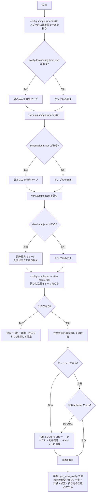

## 付録：そのほかの修正ファイルの全文

`docs/config-design.md`

````markdown
# 設定ファイルの設計

対象コード：`python/data_search/settings/`（`loader.py`・`merge.py`・`validation.py`）と `python/run_server.py`。
Rust 版では `src-tauri/src/config/` に同じ決まりで移す。

## 1. 目的

- ハードコーディングを避ける（DB パス・テーブル名・列名・表示項目・表示順をソースコードに書かない）
- 環境設定（config）・DB 定義（schema）・画面表示定義（view）を分ける
- 外部提供できるファイル（`config/sample`）と社内専用ファイル（`config/local`）を**フォルダで**分ける
- サンプルを初期値とし、ローカルは必要な項目だけを上書きする（全項目を重複して書かない）

## 2. フォルダ構成

```text
data-search/config/
├─ sample/                  外部提供可能（Git 管理対象・外部 AI へ渡してよい・社内情報を含めない）
│  ├─ config.sample.json
│  ├─ schema.sample.json
│  └─ view.sample.json
├─ local/                   社内専用（フォルダごと Git 管理対象外・外部へ出さない・なくても起動まで進む）
│  ├─ config.local.json
│  ├─ schema.local.json
│  └─ view.local.json
└─ dummy/                   ダミーデータ用の上書き（make_dummy_db.py が作る・Git 管理対象外）
   ├─ config.local.json
   └─ schema.local.json
```

`.gitignore` で `config/local/` と `config/dummy/` をフォルダごと除外する（`.gitkeep` は置かない。誤って中身を追跡しないため）。

## 3. 各ファイルの責務

| ファイル | 持つもの | 持たないもの |
|---|---|---|
| `config.sample.json` | アプリ基本情報、データソースの有効/無効・識別子・読み取り専用、共有 SQLite パスの**プレースホルダー**、キャッシュのパスと動作、検索の初期値、ログ、開発用サーバー | テーブル名、列名、論理と物理の対応、表示項目・表示順 |
| `config.local.json` | 実際の共有 SQLite のパスなど、環境で変わる値だけ | テーブル名、列名（schema へ） |
| `schema.sample.json` | データソース識別子、テーブル名の**プレースホルダー**、論理項目と物理列名（**プレースホルダー**）の対応、1 件を特定する項目（`recordKey`）、日付として扱う項目（`types`） | 表示名、表示順、表示/非表示 |
| `schema.local.json` | 実際のテーブル名・物理列名（DB 構造が変わったときの主な修正先）。社内だけの論理項目の追加 | 表示順、表示/非表示 |
| `view.sample.json` | 一覧の列（`listColumns`：論理名・表示名・表示/非表示・検索対象・幅。配列順＝表示順）、詳細の項目（`detailFields`）、詳細のまとまり（`detailGroups`）、項目ごとの表示（`fields`：表示名・等幅・コピー・入力例・値の札）、絞り込み（`filters`）、既定の並べ替え（`defaultSort`） | 物理列名 |
| `view.local.json` | 社内環境だけの表示変更（なくてよい） | 物理列名 |

`recordKey` と `types` は依頼書に明記がなかったため、**DB の論理構造**として schema に置いた（「1 件を特定する列」「日付として比べる列」はデータの性質であり、表示の都合ではないため）。

## 4. 起動時の読み込み順

1. `config/sample/config.sample.json` を読み込む
2. `config/local/config.local.json` があれば読み込む
3. ローカルをサンプルへ再帰マージする
4. `config/sample/schema.sample.json` を読み込む
5. `config/local/schema.local.json` があれば読み込む
6. ローカルをサンプルへ再帰マージする
7. `config/sample/view.sample.json` を読み込む
8. `config/local/view.local.json` があれば読み込む
9. ローカルをサンプルへマージする
10. マージ後の config・schema・view を検証する（誤りはすべて集めてから止める）
11. schema に従って共有 SQLite をコピーし、テーブルと列の存在を確かめてからキャッシュとして使う
12. view に従って検索画面を組み立てる（画面は最初に `get_view_config` で表示定義を受け取る）

`--local-dir` で `config/local` の代わりのフォルダを指定できる（ダミー用：`config/dummy`）。

## 5. マージ仕様（`settings/merge.py` の `deep_merge`）

| ローカル側の状態 | 結果 |
|---|---|
| キーがない | サンプルの値のまま（誤りにしない。例：`devServer` を書かなくてよい） |
| 両方がオブジェクト `{ }` | キーごとに再帰的に重ねる |
| 配列 `[ ]` | 要素ごとに重ねず、**配列全体を置き換える**（例：`view.listColumns`） |
| 型がサンプルと違う | 使わず、型の誤りとして止める（サンプルの値が `null` なら何でも受け入れる。整数は数値の代わりに使える） |
| サンプルにないキー | **読み捨てない**。ファイル名と項目の道筋を示して「設定の注意」を出し、その値は使わない |
| サンプルにないキー（論理項目を足せる場所） | `schema.columns`・`schema.types`・`view.fields` は新しいキーを受け入れて使う（社内だけの論理項目を足せるように） |

- サンプル側のオブジェクトは変更しない（新しいオブジェクトを作る）。
- サンプルを読んだ直後に、アプリ内の既定値（`settings/defaults.py` の `BUILTIN_DEFAULTS`）でサンプルにないキーを補う（`fill_defaults`）。
  サンプルに書いてある値が常に優先。補ったキーはサンプルにあるのと同じ扱いになり、local で上書きしても注意は出ない。

| 補う既定値 | 値 |
|---|---|
| `config.cache` | `temporaryExtension: ".tmp"`・`keepPreviousOnFailure: true` |
| `config.devServer` | `host: "127.0.0.1"`・`port: 8765`・`openBrowser: true` |
| `schema.types` | `{}`（日付の項目なし） |
| `view.detailGroups` / `view.fields` / `view.filters` | `[]` / `{}` / `[]` |
- ローカルのファイルがないときは、空の上書き `{}` として扱う。

例（view）：

```jsonc
// view.sample.json：listColumns 17 列・detailFields 83 項目
// view.local.json
{ "listColumns": [ { "field": "lotNo", "label": "ロットNo.", "visible": true, "searchable": true } ] }
// 結果：listColumns は 1 列だけ（配列は丸ごと置き換え）。detailFields・fields・filters はサンプルのまま
```

## 6. 検証（`settings/validation.py`）

仮の値（`<...>` の形）の判定は役割ごとに行う。`config.local.json` にテーブル名や列名がないことは誤りにしない。

### 6.1 config

- 各 JSON が解析できる・同じキーが重複していない・全体がオブジェクト
- `dataSource.sourcePath`・`cachePath` が仮の値でも空でもない（**接続先のパスは config で確かめる**）
- `dataSource.enabled` が true、`readOnly` が true
- `search.pageSize`・`maxPageSize` が正の整数で、`pageSize ≤ maxPageSize`
- `devServer.port` が 1〜65535、`devServer.host` が 127.0.0.1 か localhost
- `logging.level`・`search.defaultMatchMode`・`cache.temporaryExtension` の値

### 6.2 schema

- `tableName` が空でも仮の値でもない（**テーブル名・列名は schema で確かめる**）
- `columns` がオブジェクトで、論理名・物理列名が空でも仮の値でもない
- 同じキー（論理名）が重複していない（JSON の読み込み時に検出）
- `dataSourceId` が config の `dataSource.id` と同じ（別のデータソースの設定を組み合わせないため）
- `recordKey`・`types` の論理名が `columns` にある
- 接続後（キャッシュ作成時）にテーブルと、使う物理列がすべてあること（`cache_validator.py`）

### 6.3 view

- `listColumns`・`detailFields`・`filters`・`fields`・`defaultSort` が参照する論理名が、**マージ後の `schema.columns`** にある
- 同じ表示項目が重複していない（`listColumns`・`detailFields`・`filters`）
- `visible`・`searchable` が真偽値。番号で探せる項目が少なくとも 1 つある
- `filters` の `type` が values / date。date は schema の `types` で date の項目だけ
- `detailGroups[]` は `id`・`label` が必須、`fields` は配列で、中の論理名が schema にある。同じ項目を 2 つのまとまりに入れない
- `fields.<項目>.group` が `detailGroups` にある、`badge` のパターンと色が正しい
- 表示名がどこにもない項目は注意（画面に論理名が出てしまうため）。項目ごとではなく「N 項目に表示名がない」と 1 件にまとめて出す
- 表示順は配列の順、`visible: false` の列は一覧に出さない（画面側で守る）

### 6.4 誤りの表示

誤りはすべて集め、1 件ごとに次の形で表示して止まる（注意は止めずに表示する）。

```text
[設定エラー]
対象: config/sample/view.sample.json
項目: listColumns[2].field
理由: "productNo" はマージ後の schema.columns に定義されていません。
対応: schema側へ論理項目を追加するか、view側のfieldを修正してください。
```

- 「対象」は、その値を直すべきファイル。仮の値が残っているときは、サンプルではなく**ローカルのファイル**を示す（サンプルに実際の値を書かせないため）。
- ローカルのファイルがないこと自体は誤りにしない。公開サンプルだけでも検証まで進み、ローカルに書くべき項目をファイル名つきで示して止まる。

## 7. 起動フロー



文字だけで見る場合：

```text
起動
 ├─ config：sample を読む → local があれば再帰マージ
 ├─ schema：sample を読む → local があれば再帰マージ
 ├─ view  ：sample を読む → local があればマージ（配列は丸ごと置き換え）
 ├─ 検証（config → schema → view）
 │    ├─ 誤りあり → 対象・項目・理由・対応をすべて表示して停止
 │    └─ 注意あり → 表示して続ける（未知のキーなど）
 ├─ キャッシュがない／今の schema（テーブル名・列名）と合わない → 作る（コピー → テーブル・列の確認 → 置換）
 │    └─ 作れなければ古いキャッシュは使わず、画面で「データを更新してください」と示す
 └─ 画面：表示定義を受け取って組み立てる
```

## 8. 旧構成からの移行

| 旧（`config/config.local.json`） | 新 |
|---|---|
| `application` | `config/local/config.local.json`（変える項目だけ） |
| `dataSource.id` | `config/local/config.local.json`（変えるときは `schema.local.json` の `dataSourceId` も同じ値に） |
| `dataSource.enabled` | 基本はサンプル。必要なときだけ `config.local.json` |
| `dataSource.sourcePath` | `config/local/config.local.json` |
| `dataSource.cachePath` | 基本はサンプル（`./data/cache/target-data.sqlite3`）。必要なときだけ `config.local.json` |
| `dataSource.tableName` | `config/local/schema.local.json` の `tableName` |
| `dataSource.readOnly` | 基本はサンプル |
| `fieldMappings` | `config/local/schema.local.json` の `columns` |
| `cache` / `search` / `logging` / `devServer` | 基本はサンプル。必要なときだけ `config.local.json` |
| （ソースコード内の表示名・表示順・検索対象・絞り込み・状態の色分け・既定の並べ替え） | `config/sample/view.sample.json`（社内だけの変更は `view.local.json`） |
| （ソースコード内の 1 件を特定する項目・日付の項目） | `config/sample/schema.sample.json` の `recordKey`・`types` |

旧 `config.local.json` の `dataSource.tableName` や `fieldMappings` を新しい `config.local.json` にそのまま残すと、
サンプルにないキーとして「設定の注意」が出る（使われない）。`schema.local.json` へ移すこと。

## 9. 設定項目を足すときの手順

1. `config/sample/` の該当ファイルにキーを足す（社内情報でない既定値、または `<...>` の仮の値）
2. `settings/loader.py` で受け取り、`settings/validation.py` で値を確かめる
3. view / schema を変えたら `python python/tools/sync_sample_view.py`（画面だけで試すモード用の表示定義を作り直す）
4. 社内の値が必要な環境だけ、`config/local/` の該当ファイルに書き足す（不要なら何もしない）
````

`python/data_search/__init__.py`

```python
"""対象データ検索ツールの Python 版バックエンド（試用・検証用）。

Rust/Tauri 版へ移植しやすいよう、モジュール構成を src-tauri/src の構成に合わせている。

    settings/       ↔ config/（loader.rs・merge.rs・validation.rs）
    fields          ↔ models/lot.rs
    cache_copier    ↔ cache/copier.rs
    cache_validator ↔ cache/validator.rs
    cache_service   ↔ cache/mod.rs
    query           ↔ db/query.rs
    lot_service     ↔ services/lot_service.rs
    commands        ↔ commands/*.rs
    errors          ↔ errors/mod.rs
    logging_setup   ↔ logging/mod.rs
"""
```

`python/data_search/cache_service.py`

```python
"""ローカルキャッシュの更新と状態管理。

更新の流れ：共有データ → 一時ファイルへコピー → 検証 → 問題がなければ置換。
失敗したときは直前の正常なキャッシュを使い続ける。
"""

import json
import os
import sqlite3
import threading
from contextlib import contextmanager
from datetime import datetime

from . import cache_copier
from .cache_validator import open_readonly, validate_cache_file
from .errors import AppError


def to_iso(timestamp):
    if timestamp is None:
        return None
    return datetime.fromtimestamp(timestamp).astimezone().isoformat(timespec="seconds")


class CacheService:
    def __init__(self, config, logger):
        self.config = config
        self.logger = logger
        self.cache_path = config.cache_path
        self.temp_path = config.cache_path + config.temporary_extension
        self.state_path = config.cache_path + ".status.json"
        # 置換中に検索が走らないよう、更新と読み取りを 1 本の鍵で順番にする
        self.lock = threading.RLock()
        # 今の schema（テーブル名・列名）と合わないキャッシュは使わない。
        # SQLite は存在しない列名を "..." で書くと文字列として扱うため、合わないまま検索すると誤った値が返る。
        self.stale = False

    # ── 状態の読み書き ──
    def _read_state(self):
        try:
            with open(self.state_path, encoding="utf-8") as fp:
                return json.load(fp)
        except (OSError, ValueError):
            return {}

    def _write_state(self, state):
        os.makedirs(os.path.dirname(self.state_path) or ".", exist_ok=True)
        temp = self.state_path + ".writing"
        with open(temp, "w", encoding="utf-8") as fp:
            json.dump(state, fp, ensure_ascii=False, indent=2)
        os.replace(temp, self.state_path)

    def cache_available(self):
        return os.path.isfile(self.cache_path) and not self.stale

    def verify_existing(self):
        """手元のキャッシュが今の schema と合うかを確かめる（起動時）。合わなければ使わない印を付けて False。"""
        if not os.path.isfile(self.cache_path):
            return False
        try:
            validate_cache_file(self.cache_path, self.config.table_name, self.config.field_mappings)
            self.stale = False
            return True
        except AppError as error:
            self.stale = True
            self.logger.warning("existing cache does not match schema code=%s detail=%s", error.code, error.detail)
            return False

    # ── 更新 ──
    def refresh(self):
        with self.lock:
            self.logger.info("cache refresh started")
            state = self._read_state()
            try:
                source_mtime = cache_copier.copy_to_temp(self.config.source_path, self.temp_path)
                row_count = validate_cache_file(self.temp_path, self.config.table_name, self.config.field_mappings)
                os.makedirs(os.path.dirname(self.cache_path) or ".", exist_ok=True)
                os.replace(self.temp_path, self.cache_path)
                self.stale = False
            except AppError as error:
                cache_copier.remove_quietly(self.temp_path)
                using_previous = self.cache_available()
                self.logger.warning(
                    "cache refresh failed code=%s detail=%s using_previous=%s",
                    error.code, error.detail, using_previous,
                )
                state.update({
                    "lastRefreshSucceeded": False,
                    "lastRefreshAt": to_iso(datetime.now().timestamp()),
                    "usingPreviousCache": using_previous,
                    "errorCode": error.code,
                    "errorMessage": error.user_message,
                })
                self._write_state(state)
                raise
            except OSError as exc:
                cache_copier.remove_quietly(self.temp_path)
                raise AppError("CACHE_COPY_FAILED", f"replace failed: {exc}") from exc

            now = datetime.now().timestamp()
            state = {
                "lastRefreshSucceeded": True,
                "lastRefreshAt": to_iso(now),
                "sourceModifiedAt": to_iso(source_mtime),
                "sourceModifiedTs": source_mtime,
                "cacheUpdatedAt": to_iso(now),
                "usingPreviousCache": False,
                "rowCount": row_count,
                "errorCode": None,
                "errorMessage": None,
            }
            self._write_state(state)
            self.logger.info("cache refresh succeeded rows=%s", row_count)
            return {
                "success": True,
                "sourceModifiedAt": state["sourceModifiedAt"],
                "cacheUpdatedAt": state["cacheUpdatedAt"],
                "usingPreviousCache": False,
                "rowCount": row_count,
                "message": "キャッシュを更新しました。",
            }

    # ── 状態 ──
    def status(self):
        # 設定の注意（未知のキーなど）は画面の「データ」パネルにも出す。値は含めない
        config_info = {
            "settingsWarnings": [
                {"file": w.file, "path": w.path, "reason": w.reason, "action": w.action} for w in self.config.warnings
            ],
        }
        state = self._read_state()
        available = self.cache_available()
        current_source = cache_copier.source_modified_at(self.config.source_path)
        cached_source = state.get("sourceModifiedTs")
        has_update = bool(available and current_source and cached_source and current_source > cached_source)
        succeeded = state.get("lastRefreshSucceeded", available)

        if not available and self.stale:
            message = "手元のキャッシュが今の設定（テーブル名・列名）と合わないため使っていません。データを更新してください。"
        elif not available:
            message = "検索できるデータがまだありません。データを更新してください。"
        elif not succeeded:
            message = "最新のデータを取得できなかったため、前回のデータを参照しています。"
        elif has_update:
            message = "共有データに新しい更新があります。必要に応じてデータを更新してください。"
        else:
            message = "最新のキャッシュを参照しています。"

        return dict(config_info, **{
            "available": available,
            "lastRefreshSucceeded": bool(succeeded),
            "sourceModifiedAt": state.get("sourceModifiedAt"),
            "cacheUpdatedAt": state.get("cacheUpdatedAt"),
            "usingPreviousCache": bool(available and not succeeded),
            "message": message,
            "rowCount": state.get("rowCount"),
            "sourceReachable": current_source is not None,
            "sourceHasUpdate": has_update,
            "lastRefreshAt": state.get("lastRefreshAt"),
            "errorCode": None if succeeded else state.get("errorCode"),
            "errorMessage": None if succeeded else state.get("errorMessage"),
        })

    # ── 読み取り ──
    @contextmanager
    def read_connection(self):
        with self.lock:
            if not self.cache_available():
                raise AppError("CACHE_UNAVAILABLE", "cache file not found")
            try:
                conn = open_readonly(self.cache_path)
            except sqlite3.Error as exc:
                raise AppError("CACHE_UNAVAILABLE", f"cannot open cache: {exc}") from exc
            try:
                yield conn
            finally:
                conn.close()
```

`python/data_search/commands.py`

```python
"""Tauri Command と同じ名前・同じ入出力の命令を登録する。

命令を増やすときは @command("名前") を付けた関数を足すだけでよい（既存の処理は変えない）。
"""

from .errors import AppError

_REGISTRY = {}


def command(name):
    def decorator(func):
        _REGISTRY[name] = func
        return func
    return decorator


def command_names():
    return sorted(_REGISTRY)


def dispatch(name, context, payload):
    handler = _REGISTRY.get(name)
    if handler is None:
        raise AppError("UNKNOWN_COMMAND", f"unknown command: {name}")
    return handler(context, payload)


@command("search_lots")
def search_lots(ctx, payload):
    return ctx.lot_service.search(payload)


@command("list_lots")
def list_lots(ctx, payload):
    return ctx.lot_service.list(payload)


@command("get_filter_values")
def get_filter_values(ctx, payload):
    return ctx.lot_service.filter_values(payload)


@command("get_lot_detail")
def get_lot_detail(ctx, payload):
    return ctx.lot_service.detail(payload)


@command("refresh_cache")
def refresh_cache(ctx, payload):
    return ctx.cache_service.refresh()


@command("get_cache_status")
def get_cache_status(ctx, payload):
    return ctx.cache_service.status()


@command("get_view_config")
def get_view_config(ctx, payload):
    """画面の表示定義（view と、schema の論理情報）。物理名は含めない。"""
    return dict(ctx.config.public_view(), success=True)


@command("get_application_info")
def get_application_info(ctx, payload):
    return {
        "id": ctx.config.app_id,
        "name": ctx.config.app_name,
        "version": ctx.config.app_version,
    }
```

`python/data_search/errors.py`

```python
"""利用者向けメッセージと技術ログを分けるためのエラー型。

画面へ出すのは code と userMessage と detailId だけ。技術的な詳細（パス・OS エラーなど）は
detail に入れてログにだけ残す。
"""

import uuid

# code → 利用者向けメッセージ（次に取る行動が分かる文にする）
USER_MESSAGES = {
    "CONFIG_INVALID": "設定に誤りがあります。表示された「対象・項目・理由・対応」に沿って直してください。",
    "SOURCE_UNAVAILABLE": "共有データに接続できません。ネットワークと共有フォルダを確認してください。",
    "SOURCE_BUSY": "共有データが更新中のため取得できませんでした。少し待ってからもう一度更新してください。",
    "CACHE_COPY_FAILED": "共有データをコピーできませんでした。少し待ってからもう一度更新してください。",
    "CACHE_INVALID": "取得したデータが壊れていたため、使用しませんでした。",
    "CACHE_TABLE_MISSING": "取得したデータに必要な表がないため、使用しませんでした。schema.local.json の tableName を確認してください。",
    "CACHE_COLUMN_MISSING": "取得したデータに必要な列がないため、使用しませんでした。schema.local.json の columns を確認してください。",
    "CACHE_UNAVAILABLE": "検索できるデータがまだありません。データを更新してください。",
    "INVALID_REQUEST": "検索の条件が正しくありません。入力内容を確認してください。",
    "NOT_FOUND": "選んだデータが見つかりません。データが更新された可能性があります。もう一度検索してください。",
    "UNKNOWN_COMMAND": "この操作には対応していません。",
    "INTERNAL_ERROR": "予期しないエラーが発生しました。もう一度試し、続く場合は管理者へ連絡してください。",
}


class AppError(Exception):
    """アプリケーションで扱うエラー。"""

    def __init__(self, code, detail="", user_message=None):
        super().__init__(f"{code}: {detail}")
        self.code = code
        self.detail = detail
        self.user_message = user_message or USER_MESSAGES.get(code, USER_MESSAGES["INTERNAL_ERROR"])


def new_detail_id():
    """ログと画面を結び付ける短い ID。"""
    return uuid.uuid4().hex[:12].upper()


def error_response(error, detail_id):
    return {
        "success": False,
        "error": {
            "code": error.code,
            "userMessage": error.user_message,
            "detailId": detail_id,
        },
    }
```

`python/data_search/fields.py`

```python
"""検索・絞り込みの決まり（上限値など）。

論理項目の名前・検索できる項目・絞り込みの種類・1 件を特定する鍵は、ここには書かない。
config/sample の schema / view（とローカルの上書き）から settings.DataModel として組み立てる。
"""

FILTER_VALUES_MAX = 200      # 1 項目で選べる値の数の上限
FILTER_VALUE_LENGTH_MAX = 200
VALUE_LIST_LIMIT = 200       # 値の一覧として返す数の上限
RELATIVE_DAYS_MAX = 3650

MATCH_MODES = ("partial", "exact")
SORT_ORDERS = ("asc", "desc")

KEYWORD_MAX_LENGTH = 100
```

`python/data_search/lot_service.py`

```python
"""一覧・検索・絞り込み・詳細取得の業務ロジック。入力の検証もここで行う。"""

import sqlite3
import time
import unicodedata
from datetime import date, timedelta

from .errors import AppError
from .fields import (
    FILTER_VALUE_LENGTH_MAX,
    FILTER_VALUES_MAX,
    KEYWORD_MAX_LENGTH,
    MATCH_MODES,
    RELATIVE_DAYS_MAX,
    SORT_ORDERS,
    VALUE_LIST_LIMIT,
)
from .query import QueryBuilder


def normalize_keyword(value):
    """全角英数・記号を半角にそろえ、前後の空白を除く（NFKC）。"""
    return unicodedata.normalize("NFKC", value).strip()


def _to_text(value):
    if value is None:
        return None
    if isinstance(value, bytes):
        return value.decode("utf-8", errors="replace")
    if isinstance(value, float) and value.is_integer():
        return str(int(value))
    return str(value)


def _row_to_item(row, model):
    return {name: _to_text(row[index]) for index, name in enumerate(model.fields)}


def _invalid(detail, user_message=None):
    return AppError("INVALID_REQUEST", detail, user_message=user_message)


def _require_int(payload, name, default, minimum, maximum):
    value = payload.get(name, default)
    if isinstance(value, bool) or not isinstance(value, int) or not minimum <= value <= maximum:
        raise _invalid(f"{name} out of range")
    return value


def _require_object(payload):
    if not isinstance(payload, dict):
        raise _invalid("payload must be an object")
    return payload


# ── 入力の読み取り ─────────────────────────────────────────

def parse_search(payload, required, model):
    """(searchType, keyword, matchMode) か、検索なしなら None を返す。"""
    keyword = payload.get("keyword")
    if keyword is None and not required:
        return None
    if not isinstance(keyword, str):
        raise _invalid("keyword must be a string")
    keyword = normalize_keyword(keyword)
    if not keyword:
        if required:
            raise _invalid("keyword is empty", "検索する番号を入力してください。")
        return None
    if len(keyword) > KEYWORD_MAX_LENGTH:
        raise _invalid("keyword too long", f"検索する番号は {KEYWORD_MAX_LENGTH} 文字以内で入力してください。")
    search_type = payload.get("searchType")
    if search_type not in model.searchable:
        raise _invalid("unknown searchType")
    match_mode = payload.get("matchMode", "partial")
    if match_mode not in MATCH_MODES:
        raise _invalid("unknown matchMode")
    return search_type, keyword, match_mode


def _parse_relative_days(spec, name):
    value = spec.get(name)
    if value is None:
        return None
    if isinstance(value, bool) or not isinstance(value, int) or abs(value) > RELATIVE_DAYS_MAX:
        raise _invalid(f"{name} out of range")
    return value


def _parse_iso_date(spec, name):
    value = spec.get(name)
    if value in (None, ""):
        return None
    try:
        if not isinstance(value, str) or len(value) != 10:
            raise ValueError(value)
        return date.fromisoformat(value).isoformat()
    except ValueError as exc:
        raise _invalid("invalid date", "日付は 年（4 桁）・月・日 で正しく入力してください。") from exc


def parse_filters(payload, today, model):
    """画面から来た絞り込みを、QueryBuilder が受け取る形に直す。空の条件は無視する。"""
    raw = payload.get("filters") or {}
    if not isinstance(raw, dict):
        raise _invalid("filters must be an object")
    filters = []
    for name, spec in raw.items():
        kind = model.filters.get(name)
        if kind is None or not isinstance(spec, dict) or spec.get("type") != kind:
            raise _invalid(f"unknown filter: {name}")
        if kind == "values":
            values = spec.get("values")
            if not isinstance(values, list) or len(values) > FILTER_VALUES_MAX:
                raise _invalid("values must be a list")
            if any(v is not None and (not isinstance(v, str) or len(v) > FILTER_VALUE_LENGTH_MAX) for v in values):
                raise _invalid("invalid value in filter")
            if values:
                filters.append((name, kind, list(dict.fromkeys(values))))
            continue
        mode = spec.get("mode")
        if mode == "relative":
            start_days = _parse_relative_days(spec, "fromDays")
            end_days = _parse_relative_days(spec, "toDays")
            start = (today + timedelta(days=start_days)).isoformat() if start_days is not None else None
            end = (today + timedelta(days=end_days)).isoformat() if end_days is not None else None
        elif mode == "absolute":
            start, end = _parse_iso_date(spec, "from"), _parse_iso_date(spec, "to")
        else:
            raise _invalid("unknown date mode")
        if start and end and start > end:
            raise _invalid("date range reversed", "日付の範囲は「から」が「まで」より前になるようにしてください。")
        if start or end:
            filters.append((name, kind, (start, end)))
    return filters


# ── 業務ロジック ─────────────────────────────────────────

class LotService:
    def __init__(self, config, cache_service, logger, today=None):
        self.config = config
        self.cache = cache_service
        self.logger = logger
        self.model = config.model
        self.query = QueryBuilder(config.table_name, config.field_mappings, config.model)
        self._today = today  # テストで日付を固定するため

    def today(self):
        return self._today() if self._today else date.today()

    def _execute(self, sql, params, fetch):
        with self.cache.read_connection() as conn:
            try:
                cursor = conn.execute(sql, params)
                return cursor.fetchone() if fetch == "one" else cursor.fetchall()
            except sqlite3.Error as exc:
                raise AppError("CACHE_INVALID", f"query failed: {exc}") from exc

    def search(self, payload):
        """番号で検索する（04_api_spec.md の search_lots。番号は必須）"""
        return self._list(_require_object(payload), keyword_required=True)

    def list(self, payload):
        """一覧を出す。番号の検索と絞り込みはどちらも任意"""
        return self._list(_require_object(payload), keyword_required=False)

    def _list(self, payload, keyword_required):
        today = self.today()
        search = parse_search(payload, keyword_required, self.model)
        filters = parse_filters(payload, today, self.model)
        sort_key = payload.get("sortKey") or self.model.default_sort[0]
        if sort_key not in self.model.fields:
            raise _invalid("unknown sortKey")
        sort_order = payload.get("sortOrder") or (self.model.default_sort[1] if sort_key == self.model.default_sort[0] else "asc")
        if sort_order not in SORT_ORDERS:
            raise _invalid("unknown sortOrder")
        page = _require_int(payload, "page", 1, 1, 10_000_000)
        page_size = _require_int(payload, "pageSize", self.config.page_size, 1, self.config.max_page_size)

        started = time.perf_counter()
        count_sql, count_params = self.query.count(search, filters)
        rows_sql, rows_params = self.query.rows(search, filters, sort_key, sort_order, page_size, (page - 1) * page_size)
        total = self._execute(count_sql, count_params, "one")[0]
        rows = self._execute(rows_sql, rows_params, "all")
        elapsed_ms = round((time.perf_counter() - started) * 1000, 1)

        # 検索値・絞り込みの値そのものはログへ出さない（種類・件数だけ）
        self.logger.info(
            "list search=%s filters=%s total=%d elapsed_ms=%s",
            f"{search[0]}/{search[2]}/len{len(search[1])}" if search else "-",
            ",".join(name for name, _, _ in filters) or "-",
            total, elapsed_ms,
        )
        items = [_row_to_item(row, self.model) for row in rows]
        return {
            "success": True,
            "count": len(items),
            "totalCount": total,
            "page": page,
            "pageSize": page_size,
            "items": items,
            "keyword": search[1] if search else None,
            "today": today.isoformat(),
            "elapsedMs": elapsed_ms,
        }

    def filter_values(self, payload):
        """絞り込みの候補（値と件数）。ほかの絞り込みと番号の検索を反映して数える"""
        payload = _require_object(payload)
        name = payload.get("field")
        if self.model.filters.get(name) != "values":
            raise _invalid("field is not a value filter")
        search = parse_search(payload, False, self.model)
        filters = parse_filters(payload, self.today(), self.model)
        sql, params = self.query.values(name, search, filters, VALUE_LIST_LIMIT + 1)
        rows = self._execute(sql, params, "all")
        return {
            "success": True,
            "field": name,
            "values": [{"value": row[0], "count": row[1]} for row in rows[:VALUE_LIST_LIMIT]],
            "truncated": len(rows) > VALUE_LIST_LIMIT,
        }

    def detail(self, payload):
        payload = _require_object(payload)
        key_values = {}
        for name in self.model.record_key:
            value = payload.get(name)
            if value is not None and not isinstance(value, str):
                raise _invalid(f"{name} must be a string or null")
            key_values[name] = value
        if not key_values[self.model.record_key[0]]:
            raise _invalid(f"{self.model.record_key[0]} is required")

        sql, params = self.query.detail(key_values)
        rows = self._execute(sql, params, "all")
        if not rows:
            raise AppError("NOT_FOUND", "record not found")
        if len(rows) > 1:
            self.logger.warning("detail key is not unique")
        return {"success": True, "item": _row_to_item(rows[0], self.model), "duplicated": len(rows) > 1}
```

`python/data_search/query.py`

```python
"""論理条件から SQL を組み立てる。値は必ずパラメーターで渡し、文字列連結しない。

表名・列名は設定ファイルから来る値だけを使い、画面から受け取った値は論理名の一覧と照合してから使う。
"""


LIKE_ESCAPE = "\\"


def quote_identifier(name):
    return '"' + str(name).replace('"', '""') + '"'


def escape_like(value):
    return (
        value.replace(LIKE_ESCAPE, LIKE_ESCAPE * 2)
        .replace("%", LIKE_ESCAPE + "%")
        .replace("_", LIKE_ESCAPE + "_")
    )


def date_expression(column):
    """日付の列を 'YYYY-MM-DD' にそろえる式。

    'YYYY-MM-DD…'・'YYYY/MM/DD…'・'YYYYMMDD'（文字・数値どちらも）に対応する。
    月日が 1 桁の書き方（2026/1/5 など）は対象外。
    """
    text = f"CAST({column} AS TEXT)"
    return (
        f"(CASE WHEN {text} GLOB '[0-9][0-9][0-9][0-9][0-9][0-9][0-9][0-9]*' "
        f"THEN substr({text}, 1, 4) || '-' || substr({text}, 5, 2) || '-' || substr({text}, 7, 2) "
        f"ELSE replace(substr({text}, 1, 10), '/', '-') END)"
    )


def blank_expression(column):
    return f"({column} IS NULL OR TRIM(CAST({column} AS TEXT)) = '')"


class QueryBuilder:
    """
    search  … None または (searchType, keyword, matchMode)
    filters … [(論理名, "values", [値 or None, ...]) / (論理名, "date", (from, to))]
              date の from / to は 'YYYY-MM-DD' か None（日付は呼び出し側で確定させる）
    """

    def __init__(self, table_name, field_mappings, model):
        self.model = model
        self.table = quote_identifier(table_name)
        self.columns = {name: quote_identifier(field_mappings[name]) for name in model.fields}
        self.select_list = ", ".join(f"{self.columns[name]} AS {quote_identifier(name)}" for name in model.fields)

    # ── 条件 ──
    def _search_condition(self, search):
        search_type, keyword, match_mode = search
        column = self.columns[search_type]
        if match_mode == "exact":
            return f"{column} = ? COLLATE NOCASE", [keyword]
        return f"{column} LIKE ? ESCAPE '{LIKE_ESCAPE}'", [f"%{escape_like(keyword)}%"]

    def _filter_condition(self, name, kind, data):
        column = self.columns[name]
        if kind == "values":
            parts, params = [], []
            values = [value for value in data if value is not None]
            if values:
                parts.append(f"{column} IN ({', '.join('?' for _ in values)})")
                params.extend(values)
            if any(value is None for value in data):
                parts.append(blank_expression(column))
            return "(" + " OR ".join(parts) + ")", params
        # date
        start, end = data
        expression = date_expression(column)
        parts, params = [f"NOT {blank_expression(column)}"], []
        if start:
            parts.append(f"{expression} >= ?")
            params.append(start)
        if end:
            parts.append(f"{expression} <= ?")
            params.append(end)
        return "(" + " AND ".join(parts) + ")", params

    def _where(self, search, filters, exclude=None):
        parts, params = [], []
        if search:
            sql, values = self._search_condition(search)
            parts.append(sql)
            params.extend(values)
        for name, kind, data in filters:
            if name == exclude:
                continue
            sql, values = self._filter_condition(name, kind, data)
            parts.append(sql)
            params.extend(values)
        return (" WHERE " + " AND ".join(parts)) if parts else "", params

    def _sort_expression(self, name):
        return date_expression(self.columns[name]) if name in self.model.date_fields else self.columns[name]

    # ── 文 ──
    def count(self, search, filters):
        where, params = self._where(search, filters)
        return f"SELECT COUNT(*) FROM {self.table}{where}", params

    def rows(self, search, filters, sort_key, sort_order, limit, offset):
        where, params = self._where(search, filters)
        direction = "DESC" if sort_order == "desc" else "ASC"
        # 空欄は昇順・降順どちらでも最後に回す
        order_terms = [
            f"{blank_expression(self.columns[sort_key])} ASC",
            f"{self._sort_expression(sort_key)} {direction}",
        ]
        order_terms += [f"{self.columns[name]} ASC" for name in self.model.record_key if name != sort_key]
        sql = (
            f"SELECT {self.select_list} FROM {self.table}{where} "
            f"ORDER BY {', '.join(order_terms)} LIMIT ? OFFSET ?"
        )
        return sql, params + [limit, offset]

    def values(self, name, search, filters, limit):
        """項目の値の一覧と件数。自分自身の絞り込みは外して数える（選び直せるように）。"""
        column = self.columns[name]
        where, params = self._where(search, filters, exclude=name)
        value = f"CASE WHEN {blank_expression(column)} THEN NULL ELSE CAST({column} AS TEXT) END"
        sql = (
            f"SELECT {value} AS v, COUNT(*) AS c FROM {self.table}{where} "
            f"GROUP BY v ORDER BY c DESC, v ASC LIMIT ?"
        )
        return sql, params + [limit]

    def detail(self, key_values):
        # IS は NULL 同士も一致とみなす（鋳造番号が空の行にも対応する）
        where = " AND ".join(f"{self.columns[name]} IS ?" for name in self.model.record_key)
        sql = f"SELECT {self.select_list} FROM {self.table} WHERE {where} LIMIT 2"
        return sql, [key_values[name] for name in self.model.record_key]
```

`python/tools/make_dummy_db.py`

```python
"""動作確認用のダミー共有 SQLite と、それを指す上書き設定（config/dummy/）を作る。

  config/dummy/config.local.json … 共有 SQLite のパスだけ
  config/dummy/schema.local.json … テーブル名と列名だけ
  （view は上書きしない。config/sample/view.sample.json をそのまま使う）

実データは使わない。列は config/sample/schema.sample.json の論理項目すべてについて作り、
物理名はわざと論理名と違う名前（大文字のスネークケース。1 列は日本語）にして、
schema の columns（論理名 → 物理列名）が効いていることを確かめられるようにしている。

使い方:
    python python/tools/make_dummy_db.py                    … 正常なダミー（ロット 2,500 件・BOX 約 5,000 件）
    python python/tools/make_dummy_db.py --lots 50000       … 大量データ
    python python/tools/make_dummy_db.py --variant corrupt  … 壊れたファイル（異常系の確認）
        variant: normal / missing-table / missing-column / corrupt
    python python/tools/make_dummy_db.py --if-missing       … すでにあれば何もしない
起動: python python/run_server.py --local-dir config/dummy
"""

import argparse
import json
import os
import random
import re
import sqlite3
from datetime import date, timedelta

APP_ROOT = os.path.dirname(os.path.dirname(os.path.dirname(os.path.abspath(__file__))))
SCHEMA_SAMPLE = os.path.join(APP_ROOT, "config", "sample", "schema.sample.json")
SHARED_PATH = os.path.join(APP_ROOT, "data", "dummy", "shared", "dummy_shared.sqlite3")
DUMMY_DIR = os.path.join(APP_ROOT, "config", "dummy")
CONFIG_PATH = os.path.join(DUMMY_DIR, "config.local.json")
SCHEMA_PATH = os.path.join(DUMMY_DIR, "schema.local.json")
TABLE = "t_dummy_lot_box"
SEED = 20261011

# 物理名を日本語にする列（引用符で囲む処理の確認用）
JAPANESE_COLUMNS = {"customerName": "取引先_名称"}
# missing-column の確認で消す論理項目
DROP_FOR_MISSING = "cfStatus"

MATERIALS = ["A1100", "A3003", "A5052", "A6061", "A6063", "A7075"]
TEMPERS = ["O", "H14", "H24", "H32", "T5", "T6", "T651"]
CUSTOMERS = [("C0101", "サンプル工業"), ("C0102", "テスト金属"), ("C0103", "見本製作所"),
             ("C0104", "架空商事"), ("C0105", "例示精工"), ("C0106", "ダミー産業")]
EQUIPMENTS = ["鋳造1号", "熱間圧延1号", "冷間圧延1号", "冷間圧延2号", "焼鈍炉3号", "スリッター1号", "検査ライン1号"]
COURSES = ["HR→CR→AN→SL", "CR→AN→SL", "AN→SL", "SL", "CR→SL", "—"]
STATUSES = ["仕掛中", "検査待ち", "検査済み", "出荷済み", "保留", "不適合"]
SPECIAL_LOTS = ["試作-α-001", "LOT_100%-A", "LOT#5/特急", "LOT(再)-12", "LOT'Q\"-1"]


def physical_name(logical):
    if logical in JAPANESE_COLUMNS:
        return JAPANESE_COLUMNS[logical]
    return re.sub(r"(?<!^)(?=[A-Z])", "_", logical).upper()


def value_of(field, ctx, rng, today):
    """主な項目は候補から、それ以外は項目名の形から値を作る（画面のサンプルと同じ考え方）。"""
    fixed = {
        "inspectionNo": f"INS-26-{ctx['serial']:06d}",
        "castingNo": f"CST-{ctx['cast']}{ctx['lot']:06d}",
        "orderNo": f"ORD-{ctx['order']:05d}",
        "customerCode": ctx["customer"][0],
        "customerName": ctx["customer"][1],
        "orderMaterial": ctx["material"], "manufacturingMaterial": ctx["material"],
        "orderTemper": ctx["temper"], "manufacturingTemper": ctx["temper"],
        "factoryDeliveryDate": (today + timedelta(days=ctx["due"])).isoformat(),
        "salesDeliveryDate": (today + timedelta(days=ctx["due"] + 3)).isoformat(),
        "specificGravity": "2.71",
    }
    if field in fixed:
        return fixed[field]
    choices = {
        "plannedEquipmentName": EQUIPMENTS, "lastActualEquipmentName": EQUIPMENTS,
        "remainingEquipmentCourse": COURSES, "cfStatus": STATUSES,
        "wipCategory": ["仕掛", "完成", "出荷待ち"], "holdCategory": ["", "", "", "品質保留", "客先保留"],
    }
    if field in choices:
        return rng.choice(choices[field])
    rules = [
        (r"Date$", lambda: (today + timedelta(days=rng.randint(-60, 90))).isoformat()),
        (r"Thickness$", lambda: ctx["thickness"]),
        (r"Width$", lambda: ctx["width"]),
        (r"Length$", lambda: ctx["length"]),
        (r"Weight$", lambda: str(rng.randint(300, 3000))),
        (r"(Count|Quantity)$", lambda: str(rng.randint(1, 20))),
        (r"Time$", lambda: f"{rng.randint(10, 900) / 10:.1f}"),
        (r"(Category|Flag)$", lambda: rng.choice(["0", "1", "2"])),
        (r"Code$", lambda: f"{rng.choice('ABKM')}{rng.randint(1, 99):02d}"),
        (r"No$", lambda: f"{re.sub('[a-z]', '', field[:-2]).upper() or 'N'}{rng.randint(1, 99999):05d}"),
        (r"Course$", lambda: rng.choice(COURSES)),
        (r"Name$", lambda: f"{field[:-4]}-{rng.randint(1, 9)}"),
    ]
    for pattern, make in rules:
        if re.search(pattern, field):
            return make()
    return f"{field}-{rng.randint(1, 9)}"


def build_rows(lot_count, logical_fields, rng):
    today = date.today()  # 日付の絞り込み（今日〜7 日後など）をいつでも試せるよう、今日を基準にする
    rows, order, order_left, serial = [], 0, 0, 0
    for lot in range(1, lot_count + 1):
        if order_left == 0:
            order += 1
            order_left = rng.randint(1, 4)
        order_left -= 1
        lot_no = SPECIAL_LOTS[lot - 1] if lot <= len(SPECIAL_LOTS) else f"LOT-2026-{lot:05d}"
        ctx = {
            "lot": lot, "order": order, "cast": rng.randint(10, 99),
            "customer": rng.choice(CUSTOMERS), "material": rng.choice(MATERIALS), "temper": rng.choice(TEMPERS),
            "thickness": rng.choice(["0.50", "1.00", "1.50", "2.00", "3.00", "5.00"]),
            "width": str(rng.choice([1000, 1250, 1525])), "length": str(rng.choice([2000, 2500, 3000])),
            "due": rng.randint(-45, 90),
        }
        for box in range(1, rng.randint(1, 3) + 1):
            serial += 1
            ctx["serial"] = serial
            row = {field: value_of(field, ctx, rng, today) for field in logical_fields}
            row["lotNo"], row["boxNo"] = lot_no, f"{box:02d}"
            rows.append(row)
    return rows


def write_database(path, rows, logical_fields, variant):
    os.makedirs(os.path.dirname(path), exist_ok=True)
    for suffix in ("", "-wal", "-shm", "-journal"):
        if os.path.exists(path + suffix):
            os.remove(path + suffix)
    if variant == "corrupt":
        with open(path, "wb") as fp:
            fp.write(b"this is not a sqlite database" * 100)
        return

    fields = [f for f in logical_fields if not (variant == "missing-column" and f == DROP_FOR_MISSING)]
    table = "t_other" if variant == "missing-table" else TABLE
    columns = [physical_name(f) for f in fields] + ["UPDATED_AT"]
    conn = sqlite3.connect(path)
    try:
        conn.execute(f'CREATE TABLE "{table}" ({", ".join(f"""\"{c}\" TEXT""" for c in columns)})')
        conn.executemany(
            f'INSERT INTO "{table}" VALUES ({", ".join("?" for _ in columns)})',
            ([row[f] for f in fields] + ["2026-10-11T08:00:00"] for row in rows),
        )
        conn.execute(f'CREATE INDEX "idx_lot" ON "{table}" ("{physical_name("lotNo")}")')
        conn.commit()
    finally:
        conn.close()


def write_config(logical_fields):
    # config/local と同じく、サンプルから変えたい項目だけを書く
    os.makedirs(DUMMY_DIR, exist_ok=True)
    config = {
        "application": {"name": "Data Search (Dummy)"},
        "dataSource": {"sourcePath": "./data/dummy/shared/dummy_shared.sqlite3", "cachePath": "./data/cache/dummy_cache.sqlite3"},
    }
    schema = {"tableName": TABLE, "columns": {f: physical_name(f) for f in logical_fields}}
    for path, data in ((CONFIG_PATH, config), (SCHEMA_PATH, schema)):
        with open(path, "w", encoding="utf-8") as fp:
            json.dump(data, fp, ensure_ascii=False, indent=2)


def main():
    parser = argparse.ArgumentParser(description="ダミーの共有 SQLite を作る")
    parser.add_argument("--lots", type=int, default=2500, help="ロットの数（1 ロットに BOX 1〜3 件）")
    parser.add_argument("--variant", choices=["normal", "missing-table", "missing-column", "corrupt"], default="normal")
    parser.add_argument("--if-missing", action="store_true")
    args = parser.parse_args()

    if args.if_missing and all(os.path.isfile(p) for p in (SHARED_PATH, CONFIG_PATH, SCHEMA_PATH)):
        print("ダミーデータはすでにあります。")
        return
    with open(SCHEMA_SAMPLE, encoding="utf-8") as fp:
        logical_fields = list(json.load(fp)["columns"])
    rows = build_rows(args.lots, logical_fields, random.Random(SEED))
    write_database(SHARED_PATH, rows, logical_fields, args.variant)
    write_config(logical_fields)
    print(f"ダミーの共有データを作成しました（{args.variant}・ロット {args.lots:,} 件・BOX {len(rows):,} 件）: {SHARED_PATH}")
    print(f"上書き設定: {DUMMY_DIR}（config.local.json / schema.local.json）")


if __name__ == "__main__":
    main()
```

`python/tools/sync_sample_view.py`

```python
"""画面だけで試すモード（index.html を直接開いたとき）用の表示定義を、公開サンプルから作り直す。

file:// で開いた画面は JSON ファイルを読めないため、config/sample/schema.sample.json と
view.sample.json の論理情報を src/js/sample/sample-view.js に書き写して使う。
サンプルの view / schema を変えたら、このスクリプトを実行する（テストで一致を確かめている）。

使い方: python python/tools/sync_sample_view.py
"""

import json
import os
import sys

APP_ROOT = os.path.dirname(os.path.dirname(os.path.dirname(os.path.abspath(__file__))))
sys.path.insert(0, os.path.join(APP_ROOT, "python"))

from data_search.settings import public_view_of  # noqa: E402
from data_search.settings.defaults import BUILTIN_DEFAULTS  # noqa: E402
from data_search.settings.merge import fill_defaults  # noqa: E402

SAMPLE_DIR = os.path.join(APP_ROOT, "config", "sample")
OUTPUT = os.path.join(APP_ROOT, "src", "js", "sample", "sample-view.js")

TEMPLATE = """/* =========================================================
   画面だけで試すモード用の表示定義（自動生成。手で直さない）
   元: config/sample/view.sample.json と schema.sample.json の論理情報
   作り直し: python python/tools/sync_sample_view.py
   ========================================================= */
(function () {{
  'use strict';

  window.DS = window.DS || {{}};
  window.DS.sampleView = /*VIEW_JSON_START*/{json}/*VIEW_JSON_END*/;
}})();
"""


def main():
    with open(os.path.join(SAMPLE_DIR, "schema.sample.json"), encoding="utf-8") as fp:
        schema = json.load(fp)
    with open(os.path.join(SAMPLE_DIR, "view.sample.json"), encoding="utf-8") as fp:
        view = json.load(fp)
    # サンプルから省かれた任意の項目は、起動時と同じく内部の既定値で補う
    schema = fill_defaults(schema, BUILTIN_DEFAULTS["schema"])
    view = fill_defaults(view, BUILTIN_DEFAULTS["view"])
    text = json.dumps(public_view_of(schema, view), ensure_ascii=False, indent=2)
    with open(OUTPUT, "w", encoding="utf-8", newline="\n") as fp:
        fp.write(TEMPLATE.format(json=text))
    print(f"書き出しました: {OUTPUT}")


if __name__ == "__main__":
    main()
```

`tests/ui-check.js`

```javascript
/* =========================================================
   画面の動作確認スクリプト（本体とは別。必要なときだけ使う）

   使い方：
     1. src/index.html を Edge で直接開く（サンプルのモード）
     2. F12 → コンソール に、このファイルの中身をすべて貼り付けて Enter
     3. 結果が表で出る。最後に「すべて成功」と出れば OK

   ※ 確認のためにサンプルデータ・絞り込み・タグを使います（終わると元の状態に戻します）。
   ========================================================= */
(async function uiCheck() {
  'use strict';

  const app = window.DS && window.DS.app;
  const results = [];
  const wait = (ms) => new Promise((resolve) => setTimeout(resolve, ms));
  const check = (name, ok, note) => results.push({ 確認: name, 結果: ok ? '成功' : '失敗', 補足: note || '' });

  if (!app) {
    console.error('DS.app が見つかりません。index.html を開いてから実行してください。');
    return;
  }
  if (app.api.mode !== 'mock') {
    console.error('サンプルのモード（index.html を直接開いたとき）で実行してください。');
    return;
  }

  const { store, search, samples, tags } = app;
  const before = { samples: samples.loadedIds(), tags: store.get().tags.items.slice(), filters: store.get().filters };
  const result = () => store.get().search.result;
  const searchFor = async (searchType, keyword, matchMode) => {
    search.setQuery({ searchType, keyword, matchMode: matchMode || 'partial' });
    await search.run({ page: 1 });
    return result();
  };

  try {
    // ── データなし ──
    await samples.clear();
    check('データなしのとき CTA はサンプルへ案内する', search.readiness().action === 'open-samples');

    // ── 読み込むと一覧が出る（入力は不要） ──
    search.setQuery({ keyword: '' });
    await search.setFilters({});
    await samples.load('standard');
    const total = store.get().cache.status.rowCount;
    check('読み込むと入力なしで一覧が出る', result() && result().totalCount === total && total > 300, `${total} 件（ロット 300・BOX ごと）`);
    check('一覧は 100 件ずつ', result().count === 100);
    const sortKey = window.DS.domain.DEFAULT_SORT.key;
    const dates = result().items.map((item) => item[sortKey]);
    check('既定の並べ替え（view の defaultSort）の順に並ぶ', dates.every((date, i) => i === 0 || dates[i - 1] <= date), sortKey);

    // ── 番号の検索（任意） ──
    let r = await searchFor('lotNo', 'LOT-2026-00012', 'exact');
    const boxes = r.totalCount;
    check('完全一致でそのロットの BOX だけが出る', boxes >= 1 && boxes <= 3 && r.items.every((item) => item.lotNo === 'LOT-2026-00012'), `${boxes} 件`);
    r = await searchFor('lotNo', 'ｌｏｔ－２０２６－０００１２', 'exact');
    check('全角・小文字でも見つかる', r.totalCount === boxes);
    r = await searchFor('lotNo', 'NOTHING-0', 'partial');
    check('0 件も正常に表示する', r.totalCount === 0 && document.querySelector('.empty').hidden === false);
    await search.clearKeyword();
    check('入力を消すと一覧に戻る', result().totalCount === total && !store.get().search.request.keyword);

    // ── 絞り込み ──
    await search.setFilter('cfStatus', { type: 'values', values: ['仕掛中'] });
    const wip = result().totalCount;
    check('状態で絞り込める', wip > 0 && wip < total && result().items.every((item) => item.cfStatus === '仕掛中'), `${wip} 件`);
    await search.setFilter('customerName', { type: 'values', values: ['架空商事'] });
    check('取引先名でも絞り込める（かつ）', result().items.every((item) => item.cfStatus === '仕掛中' && item.customerName === '架空商事'), `${result().totalCount} 件`);
    const values = await app.api.call('get_filter_values', { field: 'cfStatus', filters: store.get().filters });
    check('値の一覧に件数が出る（自分の条件は外して数える）', values.values.length > 1);

    // ── タグ ──
    const saved = tags.save('確認用タグ');
    check('今の条件をタグにできる', saved.ok && store.get().tags.activeId === saved.tag.id);
    check('同じ名前のタグは作れない', tags.save('確認用タグ').ok === false);
    await tags.apply(null);
    check('「すべて」で絞り込みを外せる', result().totalCount === total && store.get().tags.activeId === null);
    await tags.apply(saved.tag.id);
    check('タグを押すと同じ条件に戻る', Object.keys(store.get().filters).length === 2 && store.get().tags.activeId === saved.tag.id);
    await search.setFilter('cfStatus', { type: 'values', values: ['仕掛中', '保留'] });
    check('条件を変えると「変更あり」になる', tags.isModified() === true);
    tags.remove(saved.tag.id);
    check('タグを消せる', !store.get().tags.items.some((tag) => tag.id === saved.tag.id));

    // ── 詳細 ──
    await search.setFilters({});
    await search.select(result().items[0]);
    check('行を選ぶと詳細が出る', document.getElementById('detail').hidden === false);
    search.closeDetail();

    // ── 1 ロットに BOX が複数 ──
    await samples.load('multi-box');
    r = result();
    check('同じロット番号の 3 BOX が出る', r.totalCount === 3);
    await search.select(r.items[2]);
    check('ロット番号＋BOX番号で 1 件に決まる', store.get().selection.item.boxNo === r.items[2].boxNo);
    search.closeDetail();

    // ── 更新の失敗 ──
    await samples.load('refresh-failure');
    check('更新失敗の状態では前回のデータを使う', store.get().cache.status.usingPreviousCache === true);

    // ── 片付け ──
    await samples.clear();
    check('サンプルだけを消せる', store.get().cache.status.available === false);
  } catch (error) {
    check('途中でエラー', false, error.message);
  } finally {
    // 元の状態に戻す
    await samples.clear();
    for (const id of before.samples) await samples.load(id);
    window.DS.core.storage.write('tags', before.tags);
    store.set({ tags: { items: before.tags, activeId: null } });
    search.setQuery({ keyword: '' });
    await search.setFilters(before.filters);
  }

  console.table(results);
  const failed = results.filter((row) => row.結果 !== '成功').length;
  if (failed) console.error(`${failed} 件の確認が失敗しました`);
  else console.log('%cすべて成功', 'color: green; font-weight: bold');
})();
```

